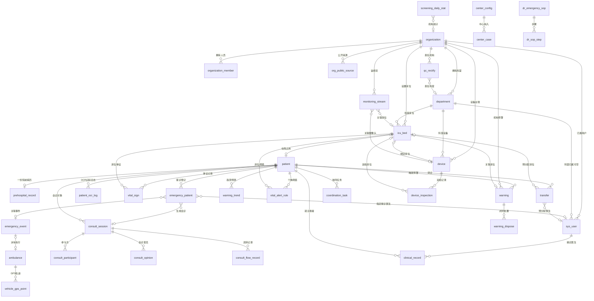

# 数据库设计文档 · 五模块字段整合（指挥中心一体化平台）

> 版本：v1.0 ｜ 编制日期：2026-10-14
> 编制依据：五份模块字段整理文档（见 §1.1），不含任何文档之外的系统或业务假设
> 文档性质：设计文档（**不含建库代码 / DDL**，全部结构以数据字典表格表达）

---

## 1. 文档说明

### 1.1 来源文档（设计输入，全量）

| 代号 | 来源文档 | 路径 | 字段条数 | 对应模块 |
|---|---|---|---|---|
| 预警档 | 03-院内早期预警模块字段整理.md v1.1 | 02-预警与重症/ | 221 | 院内早期预警（Early In-hospital Warning） |
| 县域档 | 04-县域智慧重症模块字段整理.md v1.0 | 02-预警与重症/ | 251 | 县域智慧重症（County Smart Critical Care） |
| 质控档 | 02-智能医疗质控模块字段整理.md v1.0 | 05-质控管理/ | 111 | 智能医疗质控（Intelligent Medical QC） |
| 急救档 | 03-急救调度模块界面字段整理.md v1.1 | 10-急救调度与监控专项/ | 332 | 智慧急救调度（Smart Emergency Dispatch） |
| Dr档 | 06-基层医生Dr模块字段整理.md v1.0 | 09-三大模块(基层调度、医院质控、基层医生Dr)专项/ | 160 | 基层医生Dr（Primary Care Dr.） |
| **合计** | — | — | **1075** | — |

- 五份文档的字段行均含「英文字段名/编码」全量列：接口已定义字段为**真实英文标识**，纯界面文案为**对照译名**。本设计仅将**真实英文标识**（及文档明确标注的接口枚举/取值）落库；对照译名不作为库表字段依据。
- 五份文档各自的「冲突与存疑清单」（预警档 10 项、县域档 10 项、质控档 6 项、急救档 12 项、Dr档 7 项）全部继承至本档 §9（冲突消解）与 §11（待确认汇总），不静默取舍。

### 1.2 编制规则

1. **完整覆盖**：五份文档 1075 条字段落库与否逐节可追溯，对照关系见 §10；不遗漏、不臆造。
2. **忠实原文**：业务字段以文档记录的界面/接口原值为准；接口已有英文标识的字段按标识命名，无接口依据的字段在设计补充中标注（§8）。
3. **冲突显式化**：多文档命名/枚举不一致处，一律在 §9 列明「冲突点 → 采用结论 → 理由」，禁止静默取舍。
4. **枚举全量**：所有枚举字段在字典「约束/取值」列列明全部取值；界面词与接口值并存时两者均列出并标注关系。
5. **设计补充单独标注**：通用主键/审计字段（§8）与设计新增业务字段均在字典「字段含义」列标注「设计补充」或「设计新增」。
6. **信息不足给推荐方案**：依据不足的字段/表给推荐方案并标「待确认」，汇总于 §11。
7. **不执行落地操作**：本档仅设计，不含建库代码、不含迁移脚本。

### 1.3 术语与缩写

| 术语 | 含义 |
|---|---|
| 业务表 | 承载界面真实业务数据的表，字段有接口英文标识依据 |
| 设计新增 | 五档未直接给出表结构、但为承载已记录字段而新增的表（§8.2 逐表说明理由） |
| 统计表 | 预置聚合结果表（日/周期粒度），明细仍可实时聚合 |
| 内容表 | 承载界面静态知识内容的表（SOP、用药速查、医教视频） |
| 非建表 | 纯 UI 控件/图表/演示占位等不落库字段，清单见 §10.2 |

---

## 2. 设计概述

### 2.1 设计对象与边界

- 平台由五大模块组成：智慧急救调度、院内早期预警、县域智慧重症、智能医疗质控、基层医生Dr，共享统一顶栏（机构标识、当前用户、通知、页脚声明）与「任务协同/通知/接入状态」底栏（五档公共框架一致，县域档 §3.1 序 22、急救档 §4.1）。
- 数据库定位：演示/联调系统（Laravel API + MySQL）；页脚声明「数据来自 Laravel API · 非实时 HIS / 120 · 非临床统计，正式环境对接院方接口」（质控档序 15、Dr档序 159）。表结构按正式环境可演进设计，HIS/120 实接时的差异见 §11。
- 模块间共享实体：机构（organization）/科室（department）/患者（patient）/床位（icu_bed）/会诊（consult_session）等在多档同时出现，统一建表、统一命名，各档字段合并进同一字典并在「来源」列标注出处档。

### 2.2 字段处理三分法

五档 1075 条字段按以下三类处理，逐档对照见 §10.1：

| 处理方式 | 判定标准 | 典型例子 |
|---|---|---|
| 落库（建表字段） | 字段为业务数据记录，且有接口英文标识或明确界面取值 | `rectify_no`（质控档序 44）、`bed_code`（预警档 icu_beds）、`bvid`（Dr档 §6.2） |
| 派生（不落库） | 由明细实时聚合可得的统计/汇总/占比 | `occupancyRate`、`summary24h.activeAlerts`、`bySource`、`overdue`（质控档序 27 明确「实时计算，不作为状态保存」） |
| 非建表 | 纯 UI 控件（按钮/页签/图标/面包屑/时钟/占位/空态/图例）、演示徽标、调试浮层、未接入占位参数 | 呼吸机/输注泵参数（县域档 105–112）、预览设置（142–144）、调试浮层（质控档序 111、Dr档序 159–160） |

### 2.3 与既有库表文档的衔接

- 仓库既有《09-三大模块专项/05-数据库设计表文档-三大模块.md》V1.1 已定义 sys_user、clinical_record、dr_video、organization、transfer、ambulance、emergency_event、emergency_patient、vehicle_gps_point、qc_* 等表。本档沿用其表名与命名风格（snake_case、软删除 `deleted_at`、bcrypt 存密码、手机号加密脱敏），并以五份字段文档为准**补全与修正**字段；两文档不一致处列入 §9 显式裁决。
- Dr档附录 6.2 与接口文档均已注明 `users→sys_user`、`clinical_records→clinical_record` 的对照关系，本档统一采用 05 设计命名。

### 2.4 通用设计约定

- 主键：`id` BIGINT UNSIGNED AUTO_INCREMENT（各表字典不再重复该行，见 §8.1）。
- 审计：`created_at` / `updated_at` DATETIME 全表；业务主档表增 `deleted_at` 软删除（§8.1）。
- 枚举存储：**接口已有英文字面值的按字面值存**（如 status=`pending`）；仅有界面中文词、无接口枚举的按中文原文存（如闭环 stage=「护士确认」，预警档 §4-2 冲突记录）。界面中文词一律可通过枚举 label 映射或快照列还原，不另建字典表。
- 敏感数据：`password` 仅存 bcrypt 散列（Dr档接口 §4.2）；`phone`、`id_card_no` 加密存储、界面脱敏展示（急救档 137「137****0303」）。
- 多选清单（症状、既往史、请求专业）以 JSON 数组存储，取值全集见字典（急救档 303/314/318）。

---

## 3. 命名规范

### 3.1 总则

| 项 | 规范 | 示例 |
|---|---|---|
| 表名 | 小写 snake_case，单数名词，域前缀可选 | `emergency_event`、`qc_rectify`、`dr_video` |
| 字段名 | 小写 snake_case；接口 camelCase 标识按下表转换 | `warningNo→warning_no`、`occupancyRate`（派生，不落库） |
| 主键 | `id`，BIGINT UNSIGNED，自增 | — |
| 外键 | `<被引表名单数>_id` | `patient_id`、`org_id`、`bed_id` |
| 业务编号列 | 接口为 `id/xxxId` 且具业务编码形态（EVT-/ZG02600001/AMB-1）的，命名 `*_no` 以区别自增主键 | `event_no`、`rectify_no`、`amb_no`、`record_no` |
| 时间列 | `*_at`（时刻）、`*_date`（日期） | `occurred_at`、`stat_date` |
| 布尔列 | 语义动词/形容词直接命名，TINYINT(1) | `verified`、`is_draft`、`is_focus`、`enabled`、`exportable`、`ptz_enabled` |
| 枚举列 | VARCHAR 存接口英文字面值；无接口枚举存界面原文 | `status='pending'`、`stage='护士确认'` |
| 多选列 | JSON 数组 | `symptoms`、`history`、`specialty` |
| 保留前缀 | 质控域 `qc_`、基层医生域 `dr_`、系统级 `sys_` | — |

### 3.2 接口标识 → 库字段对照示例

| 接口标识（五档记录） | 库字段 | 所属表 |
|---|---|---|
| rows[].id（ZG02600007） | rectify_no | qc_rectify |
| eventId（EVT-YYYYMMDD-NN） | event_no | emergency_event |
| warningNo | warning_no | warning |
| deviceId（MON-/CAM-） | device_no | device |
| streamId | stream_no | monitoring_stream |
| task120_id / task120Id | task120_id | emergency_patient / emergency_event |
| currentEventId | current_event_id | ambulance |
| savedAt | saved_at / registered_at | prehospital_record / emergency_patient |
| data-topic（cpr/earthquake/flu） | topic | dr_video |

---

## 4. 表清单汇总

共 **40 张表**，分 9 域。「性质」：业=业务表、子=子表/明细、统=统计表、容=内容表、设=设计新增。

### A. 公共与配置域（7 张）

| 编号 | 表名 | 中文名 | 性质 | 主要依据（档·章节） |
|---|---|---|---|---|
| A1 | sys_user | 系统用户表 | 业 | Dr档附录6.2、接口§3.1/§4；预警档序9、急救档序9 当前用户 |
| A2 | organization | 协作机构表 | 业 | 急救档§4.11；县域档§3.13；预警档§3.3 |
| A3 | department | 科室表 | 业 | 急救档§4.11；县域档序237；预警档序128 |
| A4 | organization_member | 机构人员表 | 业 | 县域档序239–247 |
| A5 | org_public_source | 机构公开资料来源表 | 设 | 县域档序243、249–251（待确认-10） |
| A6 | platform_integration | 平台集成接入表 | 业 | 预警档§3.5（六集成卡） |
| A7 | system_config | 系统配置表 | 业 | 预警档§3.5（采集周期/通知渠道等） |

### B. 患者与院前域（4 张）

| 编号 | 表名 | 中文名 | 性质 | 主要依据（档·章节） |
|---|---|---|---|---|
| B1 | patient | 患者主档表 | 业 | 预警档§3.8/§3.9；急救档§4.7/§4.13；县域档§3.12 序211 |
| B2 | prehospital_record | 院前病历表 | 业 | 急救档§4.6/§4.17（prehospital 全量字段） |
| B3 | emergency_patient | 急救接诊登记表 | 业 | 急救档§4.5/§4.8（120登记 + 指挥中枢接入登记） |
| B4 | patient_ocr_log | 证件识别日志表 | 设 | 急救档序132（POST /patients/ocr-id） |

### C. 急救调度域（3 张）

| 编号 | 表名 | 中文名 | 性质 | 主要依据（档·章节） |
|---|---|---|---|---|
| C1 | emergency_event | 急救事件表 | 业 | 急救档§4.2/§4.3 |
| C2 | ambulance | 救护车表 | 业 | 急救档§4.4 |
| C3 | vehicle_gps_point | 车辆轨迹点表 | 设 | 急救档序54（地图 GPS 轨迹） |

### D. 床位设备监控域（6 张）

| 编号 | 表名 | 中文名 | 性质 | 主要依据（档·章节） |
|---|---|---|---|---|
| D1 | icu_bed | 床位表 | 业 | 预警档§3.10；县域档§3.2/§3.3；急救档§4.12 |
| D2 | device | 床旁设备表 | 业 | 县域档§3.8/§3.9 |
| D3 | device_inspection | 设备巡检记录表 | 子 | 县域档§3.4（GET /beds/{id}/inspections）；质控档序59 |
| D4 | monitoring_stream | 监控流表 | 业 | 县域档§3.7；急救档§4.6/§4.12 |
| D5 | vital_sign | 体征记录表 | 业 | 预警档 patient_vitals；县域档§3.3/§3.4 |
| D6 | vital_alert_rule | 体征预警规则表 | 设 | 预警档备注（news≥5/SpO₂<93/心率>100）；县域档序93–96 个体阈值 |

### E. 预警域（5 张）

| 编号 | 表名 | 中文名 | 性质 | 主要依据（档·章节） |
|---|---|---|---|---|
| E1 | warning | 预警记录表 | 业 | 预警档§3.2/§3.11；县域档序52–55 |
| E2 | warning_dispose | 预警处置记录表 | 子 | 预警档§3.2 闭环/§3.9（closedLoop、dispose） |
| E3 | warning_trend | 预警趋势预测表 | 业 | 预警档§3.2（warning_trends） |
| E4 | warning_daily_stat | 预警日统计表 | 统 | 预警档§3.2（dailyTrend） |
| E5 | screening_daily_stat | 每日筛查统计表 | 统 | 预警档§3.2 每日筛查覆盖、§3.7 协作机构统计（演示口径，§11） |

### F. 会诊转诊协同域（6 张）

| 编号 | 表名 | 中文名 | 性质 | 主要依据（档·章节） |
|---|---|---|---|---|
| F1 | consult_session | 远程会诊表 | 业 | 急救档§4.9；县域档§3.12 |
| F2 | consult_participant | 会诊参与方表 | 子 | 急救档§4.9（participants[]） |
| F3 | consult_opinion | 会诊意见表 | 子 | 急救档 POST /rooms/{token}/opinions；县域档序216 |
| F4 | consult_flow_record | 流转记录表 | 子 | 急救档§4.9/§4.10（messages/milestones/records 三源合一，§9-13） |
| F5 | transfer | 转诊单表 | 业 | 急救档§4.10；县域档§3.5 开始转运弹窗 |
| F6 | coordination_task | 任务协同表 | 业 | 急救档§4.14/§4.15 |

### G. 五大中心域（2 张）

| 编号 | 表名 | 中文名 | 性质 | 主要依据（档·章节） |
|---|---|---|---|---|
| G1 | center_case | 中心纳入病例表 | 设 | 县域档§3.10/§3.11（centerId、纳入弹窗） |
| G2 | center_config | 中心配置表 | 设 | 县域档序180（centers.assessmentNote） |

### H. 质控域（2 张）

| 编号 | 表名 | 中文名 | 性质 | 主要依据（档·章节） |
|---|---|---|---|---|
| H1 | qc_rectify | 质控整改台账表 | 业 | 质控档§3.2（rectify-ledger 全字段）；qc_rectifies |
| H2 | qc_report_def | 质控报表定义表 | 业 | 质控档§3.3（defs、report_key 六键） |

### I. 基层医生Dr域（5 张）

| 编号 | 表名 | 中文名 | 性质 | 主要依据（档·章节） |
|---|---|---|---|---|
| I1 | dr_video | 医教视频表 | 容 | Dr档§3.3（data-topic/BV 映射）；接口§2.3 规划；05 库表 dr_video |
| I2 | clinical_record | 诊疗记录表 | 业 | Dr档附录6.2；接口§5 |
| I3 | dr_emergency_sop | 急救SOP知识表 | 容 | Dr档§3.2（六急症面板框架行） |
| I4 | dr_sop_step | SOP步骤表 | 容 | Dr档§3.2.1–3.2.6（步骤卡/剂量标签/要点标签） |
| I5 | dr_drug_reference | 急救用药参考表 | 容 | Dr档§3.4（12 药品行，列结构序142–146） |

---
## 5. 表结构明细（数据字典）

> 列说明：序号按表内编列；「主键」Y=主键；「非空」Y/N；「默认值」—=无；「约束/取值」列明枚举全部取值或唯一/外键约束。
> 各表主键 `id`（BIGINT UNSIGNED 自增）与审计字段 `created_at`/`updated_at`/`deleted_at` 为全表通用设计补充，见 §8.1，字典中不再逐行重复。

### 5.1 A 域 · 公共与配置

#### A1 sys_user 系统用户表

| 序号 | 字段名 | 数据类型 | 长度/精度 | 主键 | 非空 | 默认值 | 约束/取值 | 字段含义（来源） |
|---|---|---|---|---|---|---|---|---|
| 1 | username | VARCHAR | 64 | — | Y | — | UNIQUE | 登录账号（Dr档接口§4.2 unique:users） |
| 2 | password | VARCHAR | 255 | — | Y | — | bcrypt 散列，禁止明文 | 登录密码（Dr档接口§4.2；05库表§5.5） |
| 3 | real_name | VARCHAR | 100 | — | Y | — | — | 姓名（Dr档接口§4.2 max:100；预警档序9「系统管理员」演示值） |
| 4 | org_id | BIGINT UNSIGNED | — | — | N | NULL | FK→organization.id | 所属机构（Dr档接口§4.2 exists:organizations） |
| 5 | phone | VARCHAR | 128 | — | N | NULL | 加密存储，脱敏展示 | 联系电话（Dr档接口§3.1 ※05未含，按实装迁移） |
| 6 | email | VARCHAR | 128 | — | N | NULL | — | 电子邮箱（Dr档接口§3.1 ※05未含） |
| 7 | identity_type | VARCHAR | 16 | — | Y | DOCTOR | DOCTOR | 实装身份标识（Dr档接口§3.1，固定 DOCTOR） |
| 8 | role_view | VARCHAR | 16 | — | Y | doctor | doctor / director / admin（admin 为设计补充取值，承载五档公共框架「系统管理员」当前用户） | 05 设计身份字段，承载实装 identity_type（Dr档接口§4.1 代码逻辑） |
| 9 | home_route | VARCHAR | 200 | — | N | NULL | 示例 /#/dr | 登录后默认路由（Dr档接口§3.1） |
| 10 | user_status | VARCHAR | 16 | — | Y | ACTIVE | ACTIVE / DISABLED（05 枚举）；实装 USER_ACTIVE / USER_DISABLED，映射见 §9-2 | 账号状态（Dr档接口§3.1/§4.2） |
| 11 | last_login_at | DATETIME | — | — | N | NULL | — | 最后登录时间（Dr档接口§4.1） |

#### A2 organization 协作机构表

| 序号 | 字段名 | 数据类型 | 长度/精度 | 主键 | 非空 | 默认值 | 约束/取值 | 字段含义（来源） |
|---|---|---|---|---|---|---|---|---|
| 1 | name | VARCHAR | 128 | — | Y | — | — | 机构名称（急救档§4.11 orgName；县域档225–229） |
| 2 | level | VARCHAR | 16 | — | Y | — | center / city / county / township / village | 机构层级（县域档225–229 organizations.level；急救档§4.11 tier 为同一概念别名，§9-4） |
| 3 | province | VARCHAR | 64 | — | N | NULL | — | 省份（急救档§4.11） |
| 4 | city | VARCHAR | 64 | — | N | NULL | 示例 内江市 / 成都市 | 城市（急救档§4.11；县域档225–229） |
| 5 | county | VARCHAR | 64 | — | N | NULL | — | 区县（急救档§4.11） |
| 6 | town | VARCHAR | 64 | — | N | NULL | — | 乡镇（急救档§4.11） |
| 7 | verified | TINYINT(1) | — | — | Y | 0 | 0/1 | 机构资料已核实（县域档序232 organizations.verified） |
| 8 | current_operation_verified | TINYINT(1) | — | — | Y | 0 | 0/1 | 当前操作身份核实标记（急救档§4.11 currentOperationVerified） |
| 9 | public_scope | VARCHAR | 255 | — | N | NULL | — | 核实范围说明（县域档§4待确认-10 引 01-机构管理接口 verificationScope；待确认） |

#### A3 department 科室表

| 序号 | 字段名 | 数据类型 | 长度/精度 | 主键 | 非空 | 默认值 | 约束/取值 | 字段含义（来源） |
|---|---|---|---|---|---|---|---|---|
| 1 | org_id | BIGINT UNSIGNED | — | — | Y | — | FK→organization.id | 所属机构（急救档§4.11；县域档序237 公开科室 12 个） |
| 2 | name | VARCHAR | 128 | — | Y | — | — | 科室名称，示例 急诊科/重症医学科（急救档§4.11 deptName；县域档序237） |
| 3 | parent_dept_id | BIGINT UNSIGNED | — | — | N | NULL | FK→department.id | 上级科室（急救档§4.11 parentDeptId） |
| 4 | is_public | TINYINT(1) | — | — | Y | 1 | 0/1 | 是否公开科室（县域档序233/238「公开科室」页签与徽标） |

#### A4 organization_member 机构人员表

| 序号 | 字段名 | 数据类型 | 长度/精度 | 主键 | 非空 | 默认值 | 约束/取值 | 字段含义（来源） |
|---|---|---|---|---|---|---|---|---|
| 1 | org_id | BIGINT UNSIGNED | — | — | Y | — | FK→organization.id | 所属机构（县域档序239–241） |
| 2 | department_id | BIGINT UNSIGNED | — | — | N | NULL | FK→department.id | 所属科室（县域档序245/247 科室、身份范围） |
| 3 | staff_name | VARCHAR | 64 | — | Y | — | 示例 曹钰 / 康焰 | 人员姓名（县域档序239–240 staffName） |
| 4 | title | VARCHAR | 64 | — | N | NULL | 示例 主任医师、主任医师、教授 | 职称（县域档序241 title） |
| 5 | is_public | TINYINT(1) | — | — | Y | 1 | 0/1 | 是否公开医护资料（县域档序234「公开医护资料」页签；序242「公开专业资料 · 非实时值班」徽标） |
| 6 | user_id | BIGINT UNSIGNED | — | — | N | NULL | FK→sys_user.id，可空（公开资料人员可非系统账号） | 关联系统账号（县域档§3.13 本科室人员；设计补充） |

#### A5 org_public_source 机构公开资料来源表（设计新增）

| 序号 | 字段名 | 数据类型 | 长度/精度 | 主键 | 非空 | 默认值 | 约束/取值 | 字段含义（来源） |
|---|---|---|---|---|---|---|---|---|
| 1 | org_id | BIGINT UNSIGNED | — | — | Y | — | FK→organization.id | 所属机构（县域档序249–251 标题前缀「四川大学华西医院」） |
| 2 | title | VARCHAR | 128 | — | Y | — | 示例 华西坝院区科室导航 / 公众版首页 / 曹钰 | 来源标题（县域档序249–251） |
| 3 | source_url | VARCHAR | 255 | — | Y | — | 示例 https://www.wchscu.cn/departone.html | 来源链接（县域档序249–251） |
| 4 | published_at | DATE | — | — | N | NULL | 示例 2026-09-24 | 来源日期（县域档序249–251） |

> 设计新增理由：县域档序 249–251 已记录完整「标题/链接/日期」三元组，但接口未见字段定义（县域档待确认-10）；为承载已采集字段设此表，字段口径待接口确认。

#### A6 platform_integration 平台集成接入表

| 序号 | 字段名 | 数据类型 | 长度/精度 | 主键 | 非空 | 默认值 | 约束/取值 | 字段含义（来源） |
|---|---|---|---|---|---|---|---|---|
| 1 | name | VARCHAR | 64 | — | Y | — | UNIQUE；六值：120调度系统 / 短信服务 / 电子身份证/HIS、PDA / 音视频服务 / AI分析服务 | 集成名称（预警档§3.5 六张集成卡） |
| 2 | description | VARCHAR | 255 | — | N | NULL | — | 集成说明（预警档§3.5 卡片描述） |
| 3 | status | VARCHAR | 16 | — | Y | NOT_CONNECTED | 截图仅见「未接入」；其余取值待确认（§11） | 接入状态（预警档§3.5 徽标「未接入」） |
| 4 | sort_order | INT | — | — | Y | 0 | — | 卡片排序（设计补充，依据六卡固定顺序） |

#### A7 system_config 系统配置表

| 序号 | 字段名 | 数据类型 | 长度/精度 | 主键 | 非空 | 默认值 | 约束/取值 | 字段含义（来源） |
|---|---|---|---|---|---|---|---|---|
| 1 | config_key | VARCHAR | 64 | — | Y | — | UNIQUE | 配置键（预警档§3.5；键值为设计补充，见下行示例） |
| 2 | config_value | VARCHAR | 255 | — | Y | — | — | 配置值 |
| 3 | remark | VARCHAR | 255 | — | N | NULL | — | 说明（预警档§3.5 说明列） |

> 预置键（依据预警档 §3.5 界面记录）：`warning.collection_interval`=15（预警数据采集周期 15 分钟）、`notify.channel`=屏幕通知（预警通知渠道）、`icu.refresh_interval`=5（县域档序 96 ICU 刷新周期 5 秒）、`behavior.demo_scene`=off（县域档序 98/144 行为场景演示开关）。键名均为设计补充，界面已记录取值。

### 5.2 B 域 · 患者与院前

#### B1 patient 患者主档表

| 序号 | 字段名 | 数据类型 | 长度/精度 | 主键 | 非空 | 默认值 | 约束/取值 | 字段含义（来源） |
|---|---|---|---|---|---|---|---|---|
| 1 | patient_code | VARCHAR | 32 | — | Y | — | UNIQUE；示例 FIELD-001 / ER-001 / 登记号 | 患者业务编号（预警档 warnings.patientId；急救档§4.7 patientId；预警档序236 登记号） |
| 2 | name | VARCHAR | 64 | — | Y | — | 示例 刘玉梅 / 李建国 | 姓名（急救档§4.7 name；预警档 patientLabel） |
| 3 | gender | VARCHAR | 8 | — | Y | UNKNOWN | MALE / FEMALE / UNKNOWN | 性别（急救档序140 MALE/FEMALE/未知；县域档序211「女」；未知→UNKNOWN，§9-5） |
| 4 | age | SMALLINT UNSIGNED | — | — | N | NULL | 示例 66 | 年龄（急救档序134；县域档序211） |
| 5 | phone | VARCHAR | 128 | — | N | NULL | 加密存储，脱敏展示（示例 137****0303） | 联系电话（急救档§4.13） |
| 6 | id_card_no | VARCHAR | 64 | — | N | NULL | 加密存储 | 证件号（急救档序132 OCR idCard） |
| 7 | birth_date | DATE | — | — | N | NULL | — | 出生日期（急救档序132 birthDate） |
| 8 | address | VARCHAR | 255 | — | N | NULL | — | 住址（急救档序132 address） |
| 9 | nationality | VARCHAR | 32 | — | N | NULL | — | 民族（急救档序132 nationality） |
| 10 | source | VARCHAR | 16 | — | Y | local | local（接口原文）＋ 120同步（界面词，接口值待确认，§11） | 患者来源：现场登记 / 120同步（急救档序234 source=local；预警档§3.2 来源列） |
| 11 | institution_id | BIGINT UNSIGNED | — | — | N | NULL | FK→organization.id | 当前所属机构（急救档§4.8 institutionId；预警档 warnings.institutionId） |
| 12 | department_id | BIGINT UNSIGNED | — | — | N | NULL | FK→department.id | 当前所属科室（急救档§4.8 departmentId；预警档序128） |
| 13 | chief_complaint | VARCHAR | 500 | — | N | NULL | 示例 意识异常 / 发热伴抽搐 | 主诉（预警档序154；县域档序213 chiefComplaint） |
| 14 | status | VARCHAR | 16 | — | Y | registered | 界面词表：已登记 / 待接收 / 已入院 / 会诊中 / 转运中 / 已接收（英文码待确认，§9-3） | 患者业务状态（预警档§4-4；急救档序129/219） |
| 15 | is_focus | TINYINT(1) | — | — | Y | 0 | 0/1 | 重点关注标记（预警档序120「仅重点关注」勾选、§3.8 重点关注患者） |
| 16 | admitted_at | DATETIME | — | — | N | NULL | — | 入院时间（急救档序238 admittedAt） |

#### B2 prehospital_record 院前病历表

> 一名患者一份院前病历，可多次保存更新（急救档序 322 savedAt）。patient_id 唯一。

| 序号 | 字段名 | 数据类型 | 长度/精度 | 主键 | 非空 | 默认值 | 约束/取值 | 字段含义（来源） |
|---|---|---|---|---|---|---|---|---|
| 1 | patient_id | BIGINT UNSIGNED | — | — | Y | — | FK→patient.id，UNIQUE | 所属患者（急救档序301 patientId） |
| 2 | category | VARCHAR | 32 | — | Y | — | 胸痛 / 卒中 / 创伤 / 其他（单选；英文码待确认，§11） | 病类（急救档序302） |
| 3 | symptoms | JSON | — | — | N | NULL | 13 项症状清单多选（急救档序303 全集） | 症状（急救档序303） |
| 4 | complaint | VARCHAR | 500 | — | N | NULL | — | 主诉（急救档序304） |
| 5 | address | VARCHAR | 255 | — | Y | — | — | 现场地址（急救档序305，界面唯一 * 必填） |
| 6 | contact_name | VARCHAR | 64 | — | N | NULL | — | 联系人（急救档序307 contact） |
| 7 | contact_phone | VARCHAR | 128 | — | N | NULL | 加密存储 | 联系电话（急救档序308 phone） |
| 8 | onset_period | VARCHAR | 16 | — | N | NULL | 30分钟内 / 30分钟至2小时 / 2小时以上 / 不详 | 起病时间（急救档序310） |
| 9 | consciousness | VARCHAR | 16 | — | N | NULL | 意识清楚 / 意识模糊 / 无反应 | 意识（急救档序311） |
| 10 | breathing | VARCHAR | 16 | — | N | NULL | 呼吸平稳 / 呼吸费力 / 呼吸异常 | 呼吸（急救档序312） |
| 11 | mobility | VARCHAR | 16 | — | N | NULL | 可自主活动 / 活动受限 / 无法活动 | 活动能力（急救档序313） |
| 12 | specialty | JSON | — | — | N | NULL | 三类请求专业多选（急救档序314 全集） | 请求专业（急救档序314） |
| 13 | history | JSON | — | — | N | NULL | 7 项既往史多选（急救档序318 全集） | 既往史（急救档序318） |
| 14 | allergy_status | VARCHAR | 16 | — | N | NULL | 否认过敏 / 有过敏史 / 不详 | 过敏史（急救档序319） |
| 15 | saved_at | DATETIME | — | — | N | NULL | — | 保存时间（急救档序322 savedAt） |

#### B3 emergency_patient 急救接诊登记表

> 承载两处登记：120 独立页患者登记（急救档 §4.5）与指挥中枢患者接入登记（#/register，急救档 §4.8）。

| 序号 | 字段名 | 数据类型 | 长度/精度 | 主键 | 非空 | 默认值 | 约束/取值 | 字段含义（来源） |
|---|---|---|---|---|---|---|---|---|
| 1 | task120_id | VARCHAR | 32 | — | N | NULL | — | 120 任务号（急救档序57/87 task120_id） |
| 2 | vehicle_plate | VARCHAR | 16 | — | N | NULL | 示例 川K1201 | 出车车牌（急救档序58/88） |
| 3 | patient_id | BIGINT UNSIGNED | — | — | N | NULL | FK→patient.id | 落档患者（设计补充关联列） |
| 4 | event_id | BIGINT UNSIGNED | — | — | N | NULL | FK→emergency_event.id | 关联急救事件（设计补充关联列） |
| 5 | name | VARCHAR | 64 | — | Y | — | 缺失返回 400 | 患者姓名（急救档序89 name 必填） |
| 6 | gender | VARCHAR | 8 | — | N | NULL | 同 B1.gender 取值 | 性别（急救档序90） |
| 7 | age | SMALLINT UNSIGNED | — | — | N | NULL | — | 年龄（急救档序91） |
| 8 | phone | VARCHAR | 128 | — | N | NULL | 加密存储 | 联系电话（急救档序92） |
| 9 | chief_complaint | VARCHAR | 500 | — | N | NULL | — | 主诉/病情（急救档序93） |
| 10 | is_draft | TINYINT(1) | — | — | Y | 1 | 0/1（isDraft，1=草稿） | 草稿标记（急救档序94–95） |
| 11 | institution_id | BIGINT UNSIGNED | — | — | N | NULL | FK→organization.id | 接收机构（急救档序137） |
| 12 | department_id | BIGINT UNSIGNED | — | — | N | NULL | FK→department.id | 接收科室（急救档序138） |
| 13 | source_record_id | VARCHAR | 64 | — | N | NULL | UNIQUE（防 120 重复登记） | 120 来源记录号（急救档序151） |
| 14 | nominated_doctor_id | BIGINT UNSIGNED | — | — | N | NULL | FK→sys_user.id | 指定接诊医生（急救档序152 nominatedDoctorId） |
| 15 | consult_session_id | BIGINT UNSIGNED | — | — | N | NULL | FK→consult_session.id | 生成的远程会诊（急救档序146–147 consultLink） |
| 16 | registration_confirmed | TINYINT(1) | — | — | Y | 0 | 0/1 | 接收登记确认（急救档序145） |
| 17 | registered_at | DATETIME | — | — | N | NULL | — | 登记时间（急救档 savedAt→registered_at） |

#### B4 patient_ocr_log 证件识别日志表（设计新增）

| 序号 | 字段名 | 数据类型 | 长度/精度 | 主键 | 非空 | 默认值 | 约束/取值 | 字段含义（来源） |
|---|---|---|---|---|---|---|---|---|
| 1 | patient_id | BIGINT UNSIGNED | — | — | N | NULL | FK→patient.id | 回填目标患者（急救档序132 识别结果回填表单） |
| 2 | recognized_name | VARCHAR | 64 | — | N | NULL | — | 识别姓名（急救档序132 name） |
| 3 | recognized_gender | VARCHAR | 8 | — | N | NULL | 同 B1.gender 取值 | 识别性别（急救档序132 gender） |
| 4 | recognized_id_card | VARCHAR | 64 | — | N | NULL | 加密存储 | 识别证件号（急救档序132 idCard） |
| 5 | recognized_birth_date | DATE | — | — | N | NULL | — | 识别出生日期（急救档序132 birthDate） |
| 6 | recognized_address | VARCHAR | 255 | — | N | NULL | — | 识别住址（急救档序132 address） |
| 7 | recognized_nationality | VARCHAR | 32 | — | N | NULL | — | 识别民族（急救档序132 nationality） |
| 8 | image_ref | VARCHAR | 255 | — | N | NULL | — | 识别图片引用（急救档序132 imageBase64 入参；存引用路径，不存 Base64 本体，设计补充） |

> 设计新增理由：POST /patients/ocr-id 为真实接口（急救档序 132），识别结果落日志便于追溯与防重复调用；字段全集即接口返回值。

### 5.3 C 域 · 急救调度

#### C1 emergency_event 急救事件表

| 序号 | 字段名 | 数据类型 | 长度/精度 | 主键 | 非空 | 默认值 | 约束/取值 | 字段含义（来源） |
|---|---|---|---|---|---|---|---|---|
| 1 | event_no | VARCHAR | 32 | — | Y | — | UNIQUE；格式 EVT-YYYYMMDD-NN | 事件编号（急救档序38 eventId） |
| 2 | task120_id | VARCHAR | 32 | — | N | NULL | — | 关联 120 任务号（急救档序39） |
| 3 | level | VARCHAR | 16 | — | Y | — | CRITICAL / ACUTE / GENERAL（展示 重症/急症/一般；风险标签 中/高/低风险 同义呈现见 §9-7） | 事件级别（急救档序40） |
| 4 | chief_complaint | VARCHAR | 500 | — | N | NULL | — | 主诉（急救档序41） |
| 5 | pickup_address | VARCHAR | 255 | — | N | NULL | — | 上车地址（急救档序42） |
| 6 | destination | VARCHAR | 128 | — | N | NULL | 示例 威远县人民医院 | 目的地（急救档序43） |
| 7 | vehicle_id | BIGINT UNSIGNED | — | — | N | NULL | FK→ambulance.id，待派车为 NULL | 执行车辆（急救档序44 vehicleId） |
| 8 | status | VARCHAR | 16 | — | Y | STANDBY | STANDBY / DISPATCHING / ON_SCENE / RETURNING；「已接警」无枚举位见 §9-8 | 事件状态（急救档序45） |
| 9 | eta_patient_minutes | SMALLINT | — | — | N | NULL | — | 接患者预计用时/分钟（急救档序46） |
| 10 | eta_hospital_minutes | SMALLINT | — | — | N | NULL | — | 到院预计用时/分钟（急救档序47） |
| 11 | score_summary | VARCHAR | 500 | — | N | NULL | — | 评分摘要（急救档序48 score/scorePlan） |
| 12 | treat_plan | VARCHAR | 500 | — | N | NULL | — | 处置方案（急救档序49 treatPlan） |
| 13 | target_department | VARCHAR | 64 | — | N | NULL | — | 目的地科室（急救档序51） |

#### C2 ambulance 救护车表

| 序号 | 字段名 | 数据类型 | 长度/精度 | 主键 | 非空 | 默认值 | 约束/取值 | 字段含义（来源） |
|---|---|---|---|---|---|---|---|---|
| 1 | amb_no | VARCHAR | 16 | — | Y | — | UNIQUE；示例 AMB-1 | 车辆编号（急救档序76 id） |
| 2 | plate | VARCHAR | 16 | — | Y | — | UNIQUE；示例 川K1201 | 车牌（急救档序75） |
| 3 | org_id | BIGINT UNSIGNED | — | — | Y | — | FK→organization.id | 所属机构（急救档序77 org） |
| 4 | bound_hospital_org_id | BIGINT UNSIGNED | — | — | N | NULL | FK→organization.id | 绑定医院（急救档序78 boundHospital） |
| 5 | crew | VARCHAR | 128 | — | N | NULL | 示例 王建国 / 陈静（医生、护士） | 随车医护（急救档序79 crew） |
| 6 | status | VARCHAR | 16 | — | Y | STANDBY | STANDBY / DISPATCHING / ON_SCENE / RETURNING | 车辆状态（急救档序80） |
| 7 | current_event_id | BIGINT UNSIGNED | — | — | N | NULL | FK→emergency_event.id | 当前执行事件（急救档序81 currentEventId） |
| 8 | driver | VARCHAR | 64 | — | N | NULL | — | 司机（急救档序104，车内监控弹窗） |
| 9 | comm_module_status | VARCHAR | 16 | — | Y | NOT_CONNECTED | 截图见「未接入」；其余取值待确认 | 通信模块（5G）状态（急救档序105） |

#### C3 vehicle_gps_point 车辆轨迹点表（设计新增）

| 序号 | 字段名 | 数据类型 | 长度/精度 | 主键 | 非空 | 默认值 | 约束/取值 | 字段含义（来源） |
|---|---|---|---|---|---|---|---|---|
| 1 | vehicle_id | BIGINT UNSIGNED | — | — | Y | — | FK→ambulance.id | 车辆（急救档序54 地图车辆轨迹） |
| 2 | lng | DECIMAL | 10,6 | — | Y | — | — | 经度（急救档序54 GPS lng/lat） |
| 3 | lat | DECIMAL | 10,6 | — | Y | — | — | 纬度（急救档序54） |
| 4 | recorded_at | DATETIME | — | — | Y | — | — | 打点时间（轨迹按时间连线，设计补充） |

> 设计新增理由：急救档序 54 记录地图 GPS 轨迹需求（lng/lat/route），轨迹需时序打点存储；表结构为最小实现，字段口径随 03-转运与视频监控接口 确认。

---
### 5.4 D 域 · 床位设备监控

#### D1 icu_bed 床位表

| 序号 | 字段名 | 数据类型 | 长度/精度 | 主键 | 非空 | 默认值 | 约束/取值 | 字段含义（来源） |
|---|---|---|---|---|---|---|---|---|
| 1 | bed_code | VARCHAR | 32 | — | Y | — | UNIQUE(org_id, department_id, bed_code)；示例 床位1床 / 协同1床 / weiyuan-icu-2 | 床位编号（预警档序183 bedId；县域档序32 label；跨科室重复问题 §9-11） |
| 2 | label | VARCHAR | 32 | — | Y | — | 示例 床位1床～8床、协同1床～4床 | 展示名（县域档序32 icu_beds.label） |
| 3 | org_id | BIGINT UNSIGNED | — | — | Y | — | FK→organization.id | 所属机构（预警档序180 institutionId；县域档序23–26 机构筛选片） |
| 4 | department_id | BIGINT UNSIGNED | — | — | Y | — | FK→department.id | 所属科室（预警档序128 departmentId；县域档序43–45 机构·科室区块） |
| 5 | status | VARCHAR | 16 | — | Y | available | available（空床）/ occupied（在院床位） | 床位状态（预警档序182；县域档序33–34） |
| 6 | patient_id | BIGINT UNSIGNED | — | — | N | NULL | FK→patient.id | 在院患者（预警档序181 patientId） |
| 7 | admitted_at | DATETIME | — | — | N | NULL | — | 入住时间（急救档序238 admittedAt） |
| 8 | reserved_flag | TINYINT(1) | — | — | Y | 0 | 0/1 | 预留标记（县域档序42「预留」；接口汇总无 reserved 字段，县域档待确认-4，字段暂缓使用） |

> 床位统计 total/occupied/available/occupancyRate（预警档序 184–186、县域档序 28–31/39–41）为实时聚合派生值，不落库（§2.2）。

#### D2 device 床旁设备表

| 序号 | 字段名 | 数据类型 | 长度/精度 | 主键 | 非空 | 默认值 | 约束/取值 | 字段含义（来源） |
|---|---|---|---|---|---|---|---|---|
| 1 | device_no | VARCHAR | 32 | — | Y | — | UNIQUE；格式 MON-*/CAM-*（示例 MON-weiyuan-emergency-1/2/3/4、CAM-weiyuan-emergency-1/2/3） | 设备编号（县域档序155/161–162 deviceId） |
| 2 | device_type | VARCHAR | 16 | — | Y | — | monitor（监护仪）/ camera（床旁摄像头） | 设备类型（县域档序156 deviceType） |
| 3 | org_id | BIGINT UNSIGNED | — | — | Y | — | FK→organization.id | 所属机构（设计补充关联列，页面按机构管理） |
| 4 | department_id | BIGINT UNSIGNED | — | — | N | NULL | FK→department.id，示例 急诊科 | 所属科室（县域档序157 departmentName） |
| 5 | bed_id | BIGINT UNSIGNED | — | — | N | NULL | FK→icu_bed.id | 绑定床位（县域档序158/167 bedId，PUT /devices/{id}/binding） |
| 6 | status | VARCHAR | 16 | — | Y | NOT_CONNECTED | 截图仅见「未连接」；其余取值待确认 | 采集状态（县域档序159/163） |

#### D3 device_inspection 设备巡检记录表

| 序号 | 字段名 | 数据类型 | 长度/精度 | 主键 | 非空 | 默认值 | 约束/取值 | 字段含义（来源） |
|---|---|---|---|---|---|---|---|---|
| 1 | device_id | BIGINT UNSIGNED | — | — | Y | — | FK→device.id | 巡检设备（县域档§3.4 GET /beds/{id}/inspections） |
| 2 | bed_id | BIGINT UNSIGNED | — | — | N | NULL | FK→icu_bed.id | 关联床位（县域档§3.4 按床位查询巡检） |
| 3 | inspected_at | DATETIME | — | — | Y | — | — | 巡检时间（设计补充，质控档序59「巡检要求每班一次并留痕」） |
| 4 | inspector_name | VARCHAR | 64 | — | N | NULL | — | 巡检人（设计补充，留痕要求） |
| 5 | result | VARCHAR | 16 | — | N | NULL | 正常 / 异常（枚举待确认） | 巡检结果（设计补充） |
| 6 | note | VARCHAR | 500 | — | N | NULL | — | 备注（设计补充） |

> 接口仅证实「巡检记录」存在（县域档 §3.4 bindings/inspections）与质控档序 59 的留痕要求；除关联键外字段为设计补充，待确认（§11）。

#### D4 monitoring_stream 监控流表

| 序号 | 字段名 | 数据类型 | 长度/精度 | 主键 | 非空 | 默认值 | 约束/取值 | 字段含义（来源） |
|---|---|---|---|---|---|---|---|---|
| 1 | stream_no | VARCHAR | 32 | — | Y | — | UNIQUE | 流标识（县域档序138–140/149 streamId） |
| 2 | kind | VARCHAR | 16 | — | Y | — | icu / bed / vehicle | 流场景（急救档：车内监控 vehicle / 床旁监护 bed / ICU icu） |
| 3 | title | VARCHAR | 128 | — | N | NULL | 示例 威远县人民医院 · 1床～6床、连界镇卫生院 · 远程监护终端 | 展示名（县域档序138–140/130–131） |
| 4 | org_id | BIGINT UNSIGNED | — | — | N | NULL | FK→organization.id | 所属机构（县域档序138–140 机构前缀） |
| 5 | bed_id | BIGINT UNSIGNED | — | — | N | NULL | FK→icu_bed.id | 关联床位（县域档序151「单床监护」跳转 /bed/:id） |
| 6 | device_id | BIGINT UNSIGNED | — | — | N | NULL | FK→device.id | 关联摄像头设备（设计补充关联列） |
| 7 | stream_url | VARCHAR | 255 | — | N | NULL | — | 流地址（县域档§6.3 streamUrl） |
| 8 | ptz_enabled | TINYINT(1) | — | — | Y | 0 | 0/1；false 时云台操作返回 409 | 云台可用（县域档序148 ptzEnabled） |
| 9 | camera_group | VARCHAR | 32 | — | N | NULL | 户外视频 / 120急救 / 乡镇卫生院 / 重症医学科（设计补充，依据分组按钮） | 摄像头分组（县域档序134–137） |

> 云台操作 action（pan/tilt/zoom/preset/stop）、zoom（in/out）、presetId 为接口入参（县域档 §6.3），非存储字段。

#### D5 vital_sign 体征记录表

| 序号 | 字段名 | 数据类型 | 长度/精度 | 主键 | 非空 | 默认值 | 约束/取值 | 字段含义（来源） |
|---|---|---|---|---|---|---|---|---|
| 1 | patient_id | BIGINT UNSIGNED | — | — | N | NULL | FK→patient.id | 患者（预警档 patient_vitals.patientId） |
| 2 | bed_id | BIGINT UNSIGNED | — | — | N | NULL | FK→icu_bed.id | 床位（县域档§3.4 GET /beds/{id} 体征） |
| 3 | heart_rate | SMALLINT | — | — | N | NULL | 单位 bpm | 心率（预警档 HR；县域档序87 heartRate） |
| 4 | spo2 | DECIMAL | 5,1 | — | N | NULL | 单位 % | 血氧（预警档 SpO2；县域档序89 spo2） |
| 5 | resp | SMALLINT | — | — | N | NULL | 单位 rpm | 呼吸（预警档序90；县域档序90 resp） |
| 6 | systolic | SMALLINT | — | — | N | NULL | 单位 mmHg | 收缩压（县域档序88 NIBP systolic） |
| 7 | diastolic | SMALLINT | — | — | N | NULL | 单位 mmHg | 舒张压（县域档序88 NIBP diastolic） |
| 8 | temp | DECIMAL | 4,1 | — | N | NULL | 单位 ℃ | 体温（预警档 TEMP；县域档序91 temp） |
| 9 | news_score | TINYINT | — | — | N | NULL | NEWS 评分 | NEWS 评分（预警档备注 news≥5 触发预警；县域档§6.3 news） |
| 10 | measured_at | DATETIME | — | — | Y | — | — | 测量时间（预警档序 patient_vitals.measuredAt；县域档§6.3 measuredAt） |

#### D6 vital_alert_rule 体征预警规则表（设计新增）

| 序号 | 字段名 | 数据类型 | 长度/精度 | 主键 | 非空 | 默认值 | 约束/取值 | 字段含义（来源） |
|---|---|---|---|---|---|---|---|---|
| 1 | metric | VARCHAR | 16 | — | Y | — | heart_rate / spo2 / resp / temp / news | 指标（预警档备注：NEWS≥5、SpO₂<93、心率>100） |
| 2 | compare_op | VARCHAR | 8 | — | Y | — | lt / lte / gt / gte / between | 比较方式（SpO₂<93 为 lt；心率 50–120 为 between，设计补充） |
| 3 | threshold_value | DECIMAL | 6,1 | — | N | NULL | SpO₂ 93（接口）vs 血氧≥92%（县域档序95），口径 §9-10 | 阈值（单边界时使用） |
| 4 | min_value | DECIMAL | 6,1 | — | N | NULL | 示例 50 | 下限（预警档序94 心率 50–120） |
| 5 | max_value | DECIMAL | 6,1 | — | N | NULL | 示例 120 | 上限（预警档序94） |
| 6 | patient_id | BIGINT UNSIGNED | — | — | N | NULL | FK→patient.id | 个体化患者（县域档序93「个体阈值」） |
| 7 | bed_id | BIGINT UNSIGNED | — | — | N | NULL | FK→icu_bed.id | 床位级阈值（县域档序93–96 页脚阈值区） |
| 8 | enabled | TINYINT(1) | — | — | Y | 1 | 0/1 | 启用（设计补充） |

> 设计新增理由：预警档明确记录触发阈值（news≥5 / SpO₂<93 / 心率>100），县域档序 93–96 记录「个体阈值」区（心率 50–120、血氧阈值、刷新周期 5 秒）；阈值为可配置业务数据，落库而非硬编码。全局默认与个体覆盖通过 patient_id/bed_id 可空层级表达。

### 5.5 E 域 · 预警

#### E1 warning 预警记录表

| 序号 | 字段名 | 数据类型 | 长度/精度 | 主键 | 非空 | 默认值 | 约束/取值 | 字段含义（来源） |
|---|---|---|---|---|---|---|---|---|
| 1 | warning_no | VARCHAR | 32 | — | Y | — | UNIQUE | 预警编号（预警档 warnings.warningNo） |
| 2 | title | VARCHAR | 128 | — | Y | — | 示例 危重值异常 / 血氧持续偏低 | 预警标题（预警档 warnings.title） |
| 3 | patient_id | BIGINT UNSIGNED | — | — | Y | — | FK→patient.id | 患者（预警档 warnings.patientId） |
| 4 | patient_label | VARCHAR | 64 | — | N | NULL | 快照列，冗余展示名 | 患者展示名（预警档 warnings.patientLabel；快照见 §8.3） |
| 5 | institution_id | BIGINT UNSIGNED | — | — | N | NULL | FK→organization.id | 机构（预警档 warnings.institutionId） |
| 6 | department_id | BIGINT UNSIGNED | — | — | N | NULL | FK→department.id | 科室（预警档 warnings.departmentId） |
| 7 | bed_id | BIGINT UNSIGNED | — | — | N | NULL | FK→icu_bed.id | 关联床位（设计补充关联列） |
| 8 | category | VARCHAR | 16 | — | Y | — | NEWS / CRITICAL_VALUE / VASOACTIVE / COAG | 预警分类（预警档 byCategory.category 四类） |
| 9 | status | VARCHAR | 16 | — | Y | new | new / acknowledged / treating / resolved（界面词 待测评/待干预/待复评/已处置 映射 §9-1） | 预警状态（预警档 warnings.status） |
| 10 | occurred_at | DATETIME | — | — | Y | — | — | 发生时间（预警档 warnings.occurredAt） |
| 11 | source | VARCHAR | 32 | — | N | NULL | — | 预警来源（预警档§4-6：来源无接口字段，界面词 现场登记/120同步；待确认） |

#### E2 warning_dispose 预警处置记录表

| 序号 | 字段名 | 数据类型 | 长度/精度 | 主键 | 非空 | 默认值 | 约束/取值 | 字段含义（来源） |
|---|---|---|---|---|---|---|---|---|
| 1 | warning_id | BIGINT UNSIGNED | — | — | Y | — | FK→warning.id | 所属预警（预警档 closedLoop[]） |
| 2 | stage | VARCHAR | 32 | — | Y | — | 中文存值：预警触发 / 护士确认 / 医生到床 / 干预完成（高危闭环词表 护士测评/医生干预/管理探索 差异 §9-1） | 闭环阶段（预警档§4-2：closedLoop.stage 中文存值） |
| 3 | actor_name | VARCHAR | 64 | — | N | NULL | 示例 护士·王芳 | 操作人（预警档闭环节点署名） |
| 4 | note | VARCHAR | 500 | — | N | NULL | — | 处置备注（预警档 POST /warnings/{id}/dispose body.note） |
| 5 | acted_at | DATETIME | — | — | Y | — | — | 操作时间（预警档闭环节点时间） |

#### E3 warning_trend 预警趋势预测表

| 序号 | 字段名 | 数据类型 | 长度/精度 | 主键 | 非空 | 默认值 | 约束/取值 | 字段含义（来源） |
|---|---|---|---|---|---|---|---|---|
| 1 | patient_id | BIGINT UNSIGNED | — | — | Y | — | FK→patient.id | 患者（预警档 warning_trends.patient_label） |
| 2 | metric | VARCHAR | 32 | — | Y | — | — | 指标名（预警档 warning_trends.metric） |
| 3 | current_value | DECIMAL | 10,2 | — | N | NULL | — | 当前值（预警档 currentValue） |
| 4 | predicted_value | DECIMAL | 10,2 | — | N | NULL | — | 预测值（预警档 predictedValue） |
| 5 | within_minutes | INT | — | — | N | NULL | — | 预测窗口/分钟（预警档 withinMinutes） |
| 6 | note | VARCHAR | 255 | — | N | NULL | — | 说明（预警档 note） |

#### E4 warning_daily_stat 预警日统计表

| 序号 | 字段名 | 数据类型 | 长度/精度 | 主键 | 非空 | 默认值 | 约束/取值 | 字段含义（来源） |
|---|---|---|---|---|---|---|---|---|
| 1 | stat_date | DATE | — | — | Y | — | UNIQUE | 统计日（预警档 dailyTrend[].date） |
| 2 | news_count | INT | — | — | Y | 0 | — | NEWS 预警数（预警档 dailyTrend[].news） |
| 3 | critical_value_count | INT | — | — | Y | 0 | — | 危急值数（预警档 dailyTrend[].critical） |
| 4 | vasoactive_count | INT | — | — | Y | 0 | — | 血管活性药预警数（预警档 dailyTrend[].drug） |
| 5 | coag_count | INT | — | — | Y | 0 | — | 凝血预警数（预警档 dailyTrend[].coag） |

#### E5 screening_daily_stat 每日筛查统计表

> 预警档 §3.2「每日筛查覆盖」（平台日汇总行，institution_id 为 NULL）与 §3.7「下级医院/协作机构统计」（机构维度行）共用本表；口径为演示统计，正式口径待确认（§11）。

| 序号 | 字段名 | 数据类型 | 长度/精度 | 主键 | 非空 | 默认值 | 约束/取值 | 字段含义（来源） |
|---|---|---|---|---|---|---|---|---|
| 1 | stat_date | DATE | — | — | Y | — | — | 统计日（预警档序45 每日筛查覆盖） |
| 2 | institution_id | BIGINT UNSIGNED | — | — | N | NULL | FK→organization.id，NULL=平台日汇总 | 机构维度（预警档§3.7 协作机构统计） |
| 3 | covered_flag | TINYINT(1) | — | — | Y | 0 | 0/1 | 是否覆盖（预警档序46 覆盖科室/机构数） |
| 4 | his_connected | TINYINT(1) | — | — | Y | 0 | 0/1 | HIS 接入（预警档序47） |
| 5 | cis_connected | TINYINT(1) | — | — | Y | 0 | 0/1 | CIS 接入（预警档序48） |
| 6 | inpatient_count | INT | — | — | Y | 0 | — | 在院患者数（预警档序49） |
| 7 | screening_count | INT | — | — | Y | 0 | — | 完成筛查数（预警档序50） |
| 8 | new_warning_count | INT | — | — | Y | 0 | — | 新增预警数（预警档序51） |
| 9 | disposed_count | INT | — | — | Y | 0 | — | 已处置数（预警档序52） |
| 10 | focus_count | INT | — | — | Y | 0 | — | 重点关注数（预警档序53） |
| 11 | realtime_collection | TINYINT(1) | — | — | Y | 0 | 0/1 | 实时采集（预警档序54） |

### 5.6 F 域 · 会诊转诊协同

#### F1 consult_session 远程会诊表

| 序号 | 字段名 | 数据类型 | 长度/精度 | 主键 | 非空 | 默认值 | 约束/取值 | 字段含义（来源） |
|---|---|---|---|---|---|---|---|---|
| 1 | session_no | VARCHAR | 32 | — | Y | — | UNIQUE；接口 consultCode（c9f1a0 样式）vs 截图 xun-2026-002，格式 §9-12 | 会诊标识（急救档§4.9 sessionId；县域档序202） |
| 2 | room_token | VARCHAR | 64 | — | Y | — | UNIQUE；路径 /rooms/{token} | 会诊室令牌（急救档 POST /rooms/{token}/opinions；县域档§3.12） |
| 3 | consult_link | VARCHAR | 255 | — | N | NULL | 患者经短信链接进入浏览器会诊（县域档序206） | 患者入会链接（急救档序147 consultLink） |
| 4 | patient_id | BIGINT UNSIGNED | — | — | Y | — | FK→patient.id | 患者（急救档§4.9 patientId；县域档序211） |
| 5 | title | VARCHAR | 128 | — | N | NULL | 示例 刘玉梅 · 院前/县域会诊 | 会诊标题（县域档序201） |
| 6 | source_org_id | BIGINT UNSIGNED | — | — | N | NULL | FK→organization.id，示例 威远县人民医院 | 申请机构（县域档序212 sourceHospital；急救档§4.9 source/sourceHospital） |
| 7 | target_org_id | BIGINT UNSIGNED | — | — | N | NULL | FK→organization.id，示例 华西医院 | 接诊机构（急救档§4.9 target hospital） |
| 8 | source_department | VARCHAR | 64 | — | N | NULL | — | 申请方科室（急救档§4.9 source department） |
| 9 | target_department | VARCHAR | 64 | — | N | NULL | — | 接诊方科室（急救档§4.9 target department） |
| 10 | applicant_name | VARCHAR | 64 | — | N | NULL | — | 申请人（急救档序332 applicant） |
| 11 | nominated_doctor_id | BIGINT UNSIGNED | — | — | N | NULL | FK→sys_user.id；「历史会诊未指定」为空值文案（县域档序203） | 指定接诊医生（急救档序152 nominatedDoctorId；县域档序203 nominatedDoctorName） |
| 12 | media_mode | VARCHAR | 16 | — | N | NULL | — | 音视频模式（县域档§6.3 mediaMode；取值待确认） |
| 13 | status | VARCHAR | 16 | — | Y | WAITING | WAITING（待接诊）/ IN_CALL（通话中）/ FINISHED（已结束）；截图「未加入/已接收」词差异 §9-9 | 会诊状态（急救档序171） |
| 14 | started_at | DATETIME | — | — | N | NULL | — | 开始时间（急救档§4.9 时间线） |
| 15 | finished_at | DATETIME | — | — | N | NULL | — | 结束时间（急救档§4.9 时间线） |

#### F2 consult_participant 会诊参与方表

| 序号 | 字段名 | 数据类型 | 长度/精度 | 主键 | 非空 | 默认值 | 约束/取值 | 字段含义（来源） |
|---|---|---|---|---|---|---|---|---|
| 1 | session_id | BIGINT UNSIGNED | — | — | Y | — | FK→consult_session.id | 所属会诊（急救档§4.9 participants[]） |
| 2 | role | VARCHAR | 16 | — | Y | — | 患者 / 申请方医师 / 接诊专家（界面词，英文码待确认） | 参与方角色（急救档§4.9 participants.role） |
| 3 | display_name | VARCHAR | 64 | — | Y | — | — | 显示名（急救档§4.9 participants.name） |
| 4 | online_flag | TINYINT(1) | — | — | Y | 0 | 0/1 | 在线状态（急救档§4.9 participants.online） |
| 5 | joined_at | DATETIME | — | — | N | NULL | — | 加入时间（设计补充） |

#### F3 consult_opinion 会诊意见表

| 序号 | 字段名 | 数据类型 | 长度/精度 | 主键 | 非空 | 默认值 | 约束/取值 | 字段含义（来源） |
|---|---|---|---|---|---|---|---|---|
| 1 | session_id | BIGINT UNSIGNED | — | — | Y | — | FK→consult_session.id | 所属会诊（急救档 POST /rooms/{token}/opinions） |
| 2 | content | TEXT | — | — | Y | — | — | 意见内容（急救档入参 content→opinionId；县域档序216 会诊记录输入区） |
| 3 | created_by | BIGINT UNSIGNED | — | — | N | NULL | FK→sys_user.id | 记录人（县域档序217 保存会诊记录） |

#### F4 consult_flow_record 流转记录表

> 急救档 §4.9/§4.10 三套时间线字段（messages[]：title/text/actor/at；milestones[]：keyLabel/by/note；records[]：阶段/actorName）统一归并（§9-13）。会诊、转诊、事件共用。

| 序号 | 字段名 | 数据类型 | 长度/精度 | 主键 | 非空 | 默认值 | 约束/取值 | 字段含义（来源） |
|---|---|---|---|---|---|---|---|---|
| 1 | biz_type | VARCHAR | 16 | — | Y | — | consult（会诊）/ transfer（转诊转运）/ event（急救事件）/ patient（连续诊疗） | 记录场景（急救档三源场景归并，设计补充） |
| 2 | biz_id | BIGINT UNSIGNED | — | — | Y | — | — | 场景记录主键（设计补充） |
| 3 | stage | VARCHAR | 32 | — | N | NULL | 中文存值，示例 接收确认 / 转运途中 / 到院交接 | 节点/阶段（急救档§4.10 milestones.keyLabel、records 阶段） |
| 4 | content | VARCHAR | 500 | — | N | NULL | — | 记录内容（急救档§4.9 messages.text） |
| 5 | actor_name | VARCHAR | 64 | — | N | NULL | — | 操作人（急救档 actorName/milestones.by） |
| 6 | note | VARCHAR | 255 | — | N | NULL | — | 附加说明（急救档 milestones.note） |
| 7 | acted_at | DATETIME | — | — | Y | — | — | 操作时间（急救档 messages.at） |

#### F5 transfer 转诊单表

| 序号 | 字段名 | 数据类型 | 长度/精度 | 主键 | 非空 | 默认值 | 约束/取值 | 字段含义（来源） |
|---|---|---|---|---|---|---|---|---|
| 1 | patient_id | BIGINT UNSIGNED | — | — | Y | — | FK→patient.id | 患者（急救档序219 patientName） |
| 2 | from_institution_id | BIGINT UNSIGNED | — | — | Y | — | FK→organization.id | 转出机构（急救档序219 fromInstitutionId） |
| 3 | to_institution_id | BIGINT UNSIGNED | — | — | Y | — | FK→organization.id | 转入机构（急救档序219 toInstitutionId） |
| 4 | to_department | VARCHAR | 64 | — | N | NULL | — | 转入科室（急救档序219 toDept） |
| 5 | status | VARCHAR | 16 | — | Y | — | TRANSPORTING 等（急救档序219；完整枚举待确认） | 转诊状态（急救档§4.10） |
| 6 | stage | VARCHAR | 32 | — | N | NULL | 中文六节点：提出申请 / 接收确认 / 预分配床位医生 / 转运途中 / 到院交接 / 归属转入 | 当前流转阶段（急救档§4.10 转诊流程六节点） |
| 7 | receiving_doctor_id | BIGINT UNSIGNED | — | — | N | NULL | FK→sys_user.id | 预分配接诊医生（急救档§4.10 预分配医生） |
| 8 | reserved_bed_id | BIGINT UNSIGNED | — | — | N | NULL | FK→icu_bed.id | 预分配床位（急救档§4.10 预分配床位） |
| 9 | reassessment_note | VARCHAR | 500 | — | N | NULL | 开始转运弹窗唯一 * 必填 | 复评记录（县域档序120） |
| 10 | started_at | DATETIME | — | — | N | NULL | — | 开始转运时间（县域档序123 确认保存） |
| 11 | finished_at | DATETIME | — | — | N | NULL | — | 交接完成时间（急救档§4.10 到院交接） |

#### F6 coordination_task 任务协同表

| 序号 | 字段名 | 数据类型 | 长度/精度 | 主键 | 非空 | 默认值 | 约束/取值 | 字段含义（来源） |
|---|---|---|---|---|---|---|---|---|
| 1 | task_no | VARCHAR | 32 | — | Y | — | UNIQUE | 任务编号（急救档§4.14 todoId/taskId） |
| 2 | task_type | VARCHAR | 16 | — | Y | — | todo（待办）/ task（任务） | 任务类型（急救档 /coordination/todos 与 /coordination/tasks 两端点） |
| 3 | title | VARCHAR | 128 | — | Y | — | — | 任务标题（急救档§4.14） |
| 4 | patient_id | BIGINT UNSIGNED | — | — | N | NULL | FK→patient.id | 关联患者（急救档§4.14/§4.15 患者列） |
| 5 | stage | VARCHAR | 32 | — | N | NULL | 中文存值（连续诊疗任务阶段列） | 当前阶段（急救档§4.15） |
| 6 | applicant_name | VARCHAR | 64 | — | N | NULL | — | 发起人（急救档§4.15 applicant） |
| 7 | accepted_by | VARCHAR | 64 | — | N | NULL | — | 受理人（急救档§4.15 acceptedBy） |
| 8 | crew | VARCHAR | 128 | — | N | NULL | — | 随车/参与人员（急救档§4.15 crew） |
| 9 | status | VARCHAR | 16 | — | Y | — | 待确认（急救档§4.14 任务状态枚举未在界面列全） | 任务状态（急救档§4.14） |
| 10 | due_at | DATETIME | — | — | N | NULL | — | 截止时间（急救档§4.14 待办时限，设计补充） |

---
### 5.7 G 域 · 五大中心

#### G1 center_case 中心纳入病例表（设计新增）

| 序号 | 字段名 | 数据类型 | 长度/精度 | 主键 | 非空 | 默认值 | 约束/取值 | 字段含义（来源） |
|---|---|---|---|---|---|---|---|---|
| 1 | center_id | VARCHAR | 16 | — | Y | — | chest-pain（胸痛）/ stroke（卒中）/ trauma（创伤）/ maternal（危重孕产妇）/ neonatal（危重新生儿） | 救治中心（县域档序171–175 centerId 枚举） |
| 2 | patient_id | BIGINT UNSIGNED | — | — | Y | — | FK→patient.id | 纳入患者（县域档序197–198 选择当前可见患者） |
| 3 | included_by | BIGINT UNSIGNED | — | — | N | NULL | FK→sys_user.id | 纳入操作人（县域档序181/199 纳入中心患者/确认纳入） |
| 4 | included_at | DATETIME | — | — | Y | — | — | 纳入时间（设计补充） |
| 5 | status | VARCHAR | 16 | — | Y | included | included（在中心）/ pending_referral（待转诊）/ arrived（已到院）（界面统计口径：中心可见患者/待转诊/已到院，县域档序177–179；英文码设计推测，待确认） | 病例状态（县域档序177–179） |
| 6 | chief_complaint | VARCHAR | 500 | — | N | NULL | 中心病例表头列 | 主诉（县域档序187 chiefComplaint） |
| 7 | note | VARCHAR | 255 | — | N | NULL | — | 备注（设计补充） |

> 设计新增理由：县域档 §3.11「纳入中心患者」弹窗（选择患者→确认纳入）为真实写操作，§3.10 中心病例表（机构科室/主诉/操作）与三类计数（序 177–179，接口未见字段，县域档待确认-8）需落库承载；UNIQUE(center_id, patient_id)。

#### G2 center_config 中心配置表（设计新增）

| 序号 | 字段名 | 数据类型 | 长度/精度 | 主键 | 非空 | 默认值 | 约束/取值 | 字段含义（来源） |
|---|---|---|---|---|---|---|---|---|
| 1 | center_id | VARCHAR | 16 | — | Y | — | UNIQUE，同 G1.center_id 取值 | 救治中心（县域档序180 centers.assessmentNote） |
| 2 | assessment_note | VARCHAR | 255 | — | N | NULL | 示例 尚未配置机构考核标准 | 考核标准文案（县域档序180） |

### 5.8 H 域 · 质控

#### H1 qc_rectify 质控整改台账表

| 序号 | 字段名 | 数据类型 | 长度/精度 | 主键 | 非空 | 默认值 | 约束/取值 | 字段含义（来源） |
|---|---|---|---|---|---|---|---|---|
| 1 | rectify_no | VARCHAR | 32 | — | Y | — | UNIQUE；格式 ZG02600001 | 整改编号（质控档序44 qc_rectifies.rectify_id、序53–63 rows[].id） |
| 2 | title | VARCHAR | 128 | — | Y | — | 示例 ICU 个体阈值未按周期复核 | 问题标题（质控档序45 title） |
| 3 | description | VARCHAR | 500 | — | N | NULL | 问题列描述行，示例 个体征值要求至少 7 天复核一次并留痕，实际 2 张床位超期未复核 | 问题描述（质控档序45/53–63） |
| 4 | source | VARCHAR | 16 | — | Y | — | alert（规则预警）/ pathwayTimeout（绿色通道超时）/ inspection（质控检查）/ complaint（投诉反馈）/ manual（人工登记） | 问题来源（质控档序29–33/40 枚举） |
| 5 | level | TINYINT | — | — | Y | — | 1（严重）/ 2（一般）/ 3（轻微）；09 接口 SEVERITY_HIGH/MEDIUM/LOW 一一对应（§9-5） | 问题级别（质控档序41/47 level 1/2/3 + levelLabel） |
| 6 | status | VARCHAR | 16 | — | Y | pending | pending（待整改）/ rectifying（整改中）/ reviewing（待复评）/ closed（已销号） | 整改状态（质控档序51 枚举） |
| 7 | owner_name | VARCHAR | 64 | — | N | NULL | 示例 马俊（演示） | 责任人姓名（质控档序48 ownerName） |
| 8 | owner_org_id | BIGINT UNSIGNED | — | — | N | NULL | FK→organization.id | 责任机构（质控档序48 ownerOrg） |
| 9 | owner_org_name | VARCHAR | 128 | — | N | NULL | 快照列 | 责任机构名（质控档序48 ownerOrgName，§8.3） |
| 10 | owner_dept_id | BIGINT UNSIGNED | — | — | N | NULL | FK→department.id | 责任科室（质控档序48 ownerDept） |
| 11 | owner_dept_name | VARCHAR | 128 | — | N | NULL | 快照列 | 责任科室名（质控档序48 ownerDeptName，§8.3） |
| 12 | found_at | DATETIME | — | — | Y | — | 09 接口 discovered_at 同义（§9-6） | 发现时间（质控档序49 foundAt，示例 2026/10/14 08:20:00） |
| 13 | deadline | DATETIME | — | — | Y | — | 09 接口 due_at 同义（§9-6） | 整改期限（质控档序50，示例 2026/10/28 17:00:00） |
| 14 | closed_at | DATETIME | — | — | N | NULL | status=closed 时有值 | 销号时间（质控档序53/63；09 接口 closed_at） |
| 15 | measure | VARCHAR | 500 | — | N | NULL | — | 整改措施（qc_rectifies.measure，质控档§1.3 引） |

> `overdue`（已超期，质控档序 60）为「未销号且 deadline 已过」的**实时计算**结果，不落库（质控档序 27 明确口径）。`is_on_time_completed`（09 接口）由 closed_at ≤ deadline 推导，不落库。

#### H2 qc_report_def 质控报表定义表

| 序号 | 字段名 | 数据类型 | 长度/精度 | 主键 | 非空 | 默认值 | 约束/取值 | 字段含义（来源） |
|---|---|---|---|---|---|---|---|---|
| 1 | report_key | VARCHAR | 32 | — | Y | — | UNIQUE；rectify / responseTime / pathway / volume / disease / cooperation | 报表键（质控档序101–106 report_key 六键） |
| 2 | name | VARCHAR | 64 | — | Y | — | 示例 质控整改台账 / 急救时效统计（待接入） | 报表名称（质控档序96/101–106） |
| 3 | category | VARCHAR | 16 | — | Y | — | 质控 / 时效 / 业务量 / 病种 / 机构（质控档序90–95/101–106） | 报表分类（质控档序97 category） |
| 4 | content | VARCHAR | 255 | — | N | NULL | 示例 到院反应时长、现场处置时长、转运时长的分位统计 | 统计内容（质控档序98/101–106） |
| 5 | dimension | VARCHAR | 32 | — | N | NULL | 不限 / 日 / 周 / 月 / 季度 | 统计维度（质控档序99/101–106） |
| 6 | exportable | TINYINT(1) | — | — | Y | 0 | 0/1；仅 rectify=true（「仅台账可导出」） | 可导出（质控档序89/107 exportable） |

> 统计卡（问题闭环率/整改按时完成率/当周发现问题数，质控档序 21–23/72–74）、byStatus/bySource/trend 图表、metrics{key,label,value,unit}、summary{total,overdue,levelDist} 均为**派生聚合**，不落库（§2.2；key 口径见质控档待确认-1 → §11）。

### 5.9 I 域 · 基层医生Dr

#### I1 dr_video 医教视频表

| 序号 | 字段名 | 数据类型 | 长度/精度 | 主键 | 非空 | 默认值 | 约束/取值 | 字段含义（来源） |
|---|---|---|---|---|---|---|---|---|
| 1 | title | VARCHAR | 128 | — | Y | — | 示例 循环心肺复苏，专治呼吸心跳骤停 / 地震时正确求生法 / 流感疫苗 | 视频标题（Dr档序119–121 播放列表行） |
| 2 | topic | VARCHAR | 32 | — | Y | — | UNIQUE；cpr / earthquake / flu（可扩展） | data-topic 映射键（Dr档序119–121 data-topic；接口§2.2 topic→BV 映射） |
| 3 | source_type | VARCHAR | 16 | — | Y | BILIBILI | LOCAL / BILIBILI | 来源类型（Dr档附录6.2 source_type） |
| 4 | bvid | VARCHAR | 32 | — | N | NULL | 示例 BV1Sp4y1z7wN / BV1sA411J7WY / BV1BmCLBmE3D；source_type=BILIBILI 时必填 | B 站 BV 号（Dr档序119–121 备注） |
| 5 | local_path | VARCHAR | 255 | — | N | NULL | 示例 /media/*.mp4；source_type=LOCAL 时必填 | 本地视频路径（Dr档序123「本地视频文件」；接口§2.2） |
| 6 | cover_url | VARCHAR | 255 | — | N | NULL | — | 封面图（规划接口 coverUrl；05 库表无封面列，设计补充） |
| 7 | sort_order | INT | — | — | Y | 0 | 列表序号 01/02/03 | 排序（Dr档附录6.2 sort_order） |
| 8 | enabled | TINYINT(1) | — | — | Y | 1 | 0/1 | 启用（Dr档附录6.2 enabled） |
| 9 | category_label | VARCHAR | 32 | — | N | NULL | 示例 应急急救；02/03 分类小字辨认存疑（Dr档待确认-3） | 分类标签（Dr档序110/119–121） |
| 10 | source_label | VARCHAR | 64 | — | N | NULL | 示例 广州市健康科普 | 来源（Dr档序118/120–121） |

> `embedUrl`（规划接口）由 source_type+bvid/local_path 拼装派生，不落库（Dr档接口§2.3 代码逻辑）。

#### I2 clinical_record 诊疗记录表

| 序号 | 字段名 | 数据类型 | 长度/精度 | 主键 | 非空 | 默认值 | 约束/取值 | 字段含义（来源） |
|---|---|---|---|---|---|---|---|---|
| 1 | record_no | VARCHAR | 32 | — | Y | — | UNIQUE，模型生成 | 记录编号（Dr档附录6.2 record_code） |
| 2 | patient_id | BIGINT UNSIGNED | — | — | Y | — | FK→patient.id | 患者（Dr档接口§5 POST 必填） |
| 3 | doctor_id | BIGINT UNSIGNED | — | — | Y | — | FK→sys_user.id（doctor_user_id→doctor_id） | 接诊医生（Dr档接口§5；doctor_name 关联输出） |
| 4 | org_id | BIGINT UNSIGNED | — | — | N | NULL | FK→organization.id | 所属机构（Dr档接口§5 GET 筛选 org_id） |
| 5 | record_type | VARCHAR | 16 | — | Y | OUTPATIENT | OUTPATIENT（门诊）等 | 记录类型（Dr档接口§5 默认 OUTPATIENT） |
| 6 | chief_complaint | VARCHAR | 500 | — | N | NULL | — | 主诉（Dr档接口§5） |
| 7 | diagnosis | VARCHAR | 500 | — | N | NULL | — | 诊断（Dr档接口§5） |
| 8 | treatment | VARCHAR | 500 | — | N | NULL | — | 处置（Dr档接口§5） |
| 9 | visit_at | DATETIME | — | — | Y | — | — | 就诊时间（Dr档接口§5 POST 必填） |

#### I3 dr_emergency_sop 急救SOP知识表

| 序号 | 字段名 | 数据类型 | 长度/精度 | 主键 | 非空 | 默认值 | 约束/取值 | 字段含义（来源） |
|---|---|---|---|---|---|---|---|---|
| 1 | title | VARCHAR | 64 | — | Y | — | UNIQUE；六值：过敏性休克 / 心搏骤停 / 心肺复苏 / 急性胸痛 / 疑似心梗 / 急性卒中 / 外伤大出血 / 止血 / 糖尿病急症 | 面板标题（Dr档序23–28/29/43/57/69/82/94） |
| 2 | level_label | VARCHAR | 32 | — | Y | — | 示例 1级 · 立即抢救 / 1级 · 时间即心肌 / II级 · 快速控制 | 级别徽标文案（Dr档序30/44/58/70/83/95） |
| 3 | tip_text | VARCHAR | 255 | — | Y | — | 示例 黄金 5 分钟 · 首选肌注肾上腺素 / 高质量按压 · 每分钟 100–120 次 | 右上红色提示（Dr档序31/45/59/71/84/96） |
| 4 | caution_note | VARCHAR | 500 | — | N | NULL | 示例 禁忌：肾上腺素禁用于静脉推注（除非心搏骤停）…… | 底部禁忌/提示条（Dr档序42/56/68/81/93/107） |
| 5 | sort_order | INT | — | — | Y | 0 | 左栏急症项顺序 | 排序（Dr档序23–28，设计补充） |

#### I4 dr_sop_step SOP步骤表

| 序号 | 字段名 | 数据类型 | 长度/精度 | 主键 | 非空 | 默认值 | 约束/取值 | 字段含义（来源） |
|---|---|---|---|---|---|---|---|---|
| 1 | sop_id | BIGINT UNSIGNED | — | — | Y | — | FK→dr_emergency_sop.id | 所属 SOP 面板（Dr档§3.2.1–3.2.6） |
| 2 | step_no | TINYINT | — | — | Y | — | 1–6 | 步骤序号（Dr档每面板 6 步） |
| 3 | step_title | VARCHAR | 64 | — | Y | — | 示例 立即停药 / 停用可疑致敏原、胸外按压 | 步骤标题（Dr档序32/48 等） |
| 4 | step_desc | VARCHAR | 500 | — | N | NULL | 示例 停止可疑药物、食品或接触物；平卧位，下肢抬高，保持气道通畅。 | 步骤说明（Dr档步骤卡说明） |
| 5 | tip_label | VARCHAR | 255 | — | N | NULL | 剂量标签/要点标签，示例 成人 0.3–0.5 mg（1:1000）；儿童 0.01 mg/kg·最大 0.3 mg；按压 : 通气 = 30 : 2 | 挂于步骤下的剂量/要点标签（Dr档序34/49/63/75 等） |
| 6 | is_critical | TINYINT(1) | — | — | Y | 0 | 0/1；红色左边条=不可省略关键动作 | 关键步骤标记（Dr档序21/32 等） |

#### I5 dr_drug_reference 急救用药参考表

| 序号 | 字段名 | 数据类型 | 长度/精度 | 主键 | 非空 | 默认值 | 约束/取值 | 字段含义（来源） |
|---|---|---|---|---|---|---|---|---|
| 1 | drug_name | VARCHAR | 64 | — | Y | — | 12 值：肾上腺素 / 阿托品 / 硝酸甘油 / 胺碘酮 / 甲泼尼龙 / 地塞米松 / 对乙酰氨基酚 / 异丙嗪 / 沙丁胺醇雾化 / 50% 葡萄糖 / 胰岛素（短效）/ 氨甲环酸 | 药品名（Dr档序147–158） |
| 2 | category | VARCHAR | 16 | — | Y | — | 急救 / 心血管 / 激素 / 解热镇痛 / 抗过敏 / 呼吸 / 代谢 / 止血 | 分类（Dr档序134–141 筛选页签、序147–158 分类徽标） |
| 3 | common_dosage | VARCHAR | 255 | — | Y | — | 示例 肌注 0.3–0.5 mg（1:1000）；心搏骤停 1 mg 静推 / 3–5 min | 常用剂量（Dr档序143/147–158） |
| 4 | indications | VARCHAR | 500 | — | N | NULL | 示例 过敏性休克一线；心搏骤停 | 适应证（Dr档序144/147–158） |
| 5 | caution_note | VARCHAR | 500 | — | N | NULL | 示例 禁静脉推注（除心搏骤停）；冠心病、老年慎用 | 禁忌 / 慎用（Dr档序145/147–158） |
| 6 | compatibility | VARCHAR | 500 | — | N | NULL | 示例 避免与碱性液同管；与 α 受体阻滞剂合用可减弱效应 | 配伍要点（Dr档序146/147–158） |
| 7 | sort_order | INT | — | — | Y | 0 | — | 排序（设计补充，依表格行序） |

> 用药速查筛选页签（全部/急救/心血管/激素/解热镇痛/抗过敏/呼吸/代谢/止血，Dr档序 133–141）由 category 字段支撑，无需单独表。搜索框（Dr档序 13「搜索症状 / 急症 / 药品」）为前端检索，命中 I3/I4/I5 内容表，不产生新表。

---

## 6. 实体关系说明

### 6.1 全域 ER 图（Mermaid）

> 40 张表中 34 张入图，合并为**单图**（多块分图在部分 Markdown 预览器中后续图不渲染）；其余 6 张为无外键的独立配置/内容/统计表（platform_integration、system_config、warning_daily_stat、qc_report_def、dr_video、dr_drug_reference）。实体名与 §5 表名一致，按 域一 机构/用户/患者/调度 → 域二 监护/预警 → 域三 会诊/转诊/协同/中心/质控/Dr → 域四 设备监控补充 顺序排布。

> 说明：Mermaid erDiagram 不支持复合外键，`qc_rectify.owner_org_id → organization.id`、`qc_rectify.owner_dept_id → department.id`、`center_case.center_id`（字符串键 → center_config.center_id）、`transfer.from/to_institution_id → organization.id` 等关系以文字列明于 §6.2，图中从略或以注释表达。

### 6.2 关系明细表（含 Mermaid 未表达部分）

| 序 | 关系 | 基数 | 外键 | 依据（档·序号） |
|---|---|---|---|---|
| 1 | organization → department | 1:N | department.org_id | 急救档§4.11；县域档序237 |
| 2 | organization → sys_user | 1:N | sys_user.org_id | Dr档接口§4.2 |
| 3 | organization → icu_bed | 1:N | icu_bed.org_id | 预警档序180；县域档序23–26 |
| 4 | department → icu_bed | 1:N | icu_bed.department_id | 预警档序128 |
| 5 | icu_bed ↔ device | 1:1（可空） | device.bed_id | 县域档序158/167 |
| 6 | icu_bed ↔ patient（在院） | 1:0..1 | icu_bed.patient_id | 预警档序181 |
| 7 | patient → prehospital_record | 1:0..1 | prehospital_record.patient_id（UNIQUE） | 急救档序301 |
| 8 | patient → emergency_patient | 1:N | emergency_patient.patient_id | 急救档§4.5/§4.8 |
| 9 | ambulance → vehicle_gps_point | 1:N | vehicle_gps_point.vehicle_id | 急救档序54 |
| 10 | emergency_event ↔ ambulance | 0..1:0..1 | emergency_event.vehicle_id + ambulance.current_event_id 双向 | 急救档序44/81 |
| 11 | patient → vital_sign | 1:N | vital_sign.patient_id | 预警档 patient_vitals |
| 12 | patient → warning | 1:N | warning.patient_id | 预警档 warnings.patientId |
| 13 | warning → warning_dispose | 1:N | warning_dispose.warning_id | 预警档 closedLoop |
| 14 | patient/bed → vital_alert_rule | 1:N | vital_alert_rule.patient_id/bed_id（可空层级） | 预警档备注；县域档序93–96 |
| 15 | patient → consult_session | 1:N | consult_session.patient_id | 急救档§4.9 |
| 16 | consult_session → participant/opinion/flow_record | 1:N | 各表 session_id | 急救档§4.9 |
| 17 | transfer → organization ×2 | N:2 | from_institution_id / to_institution_id | 急救档序219 |
| 18 | transfer → icu_bed / sys_user | N:0..1 | reserved_bed_id / receiving_doctor_id | 急救档§4.10 |
| 19 | center_config → center_case | 1:N | center_case.center_id（字符串键） | 县域档序171–180 |
| 20 | qc_rectify → organization/department | N:0..1 | owner_org_id / owner_dept_id | 质控档序48 |
| 21 | clinical_record → patient/sys_user | N:1 | patient_id / doctor_id | Dr档接口§5 |
| 22 | dr_emergency_sop → dr_sop_step | 1:N | dr_sop_step.sop_id | Dr档§3.2 |
| 23 | organization → monitoring_stream | 1:N | monitoring_stream.org_id | 县域档§3.7 |
| 24 | monitoring_stream → icu_bed/device | N:0..1 | monitoring_stream.bed_id / device_id（可空） | 县域档§3.7 |
| 25 | device → device_inspection | 1:N | device_inspection.device_id | 县域档§3.4（GET /beds/{id}/inspections） |
| 26 | device_inspection → icu_bed | N:0..1 | device_inspection.bed_id（可空） | 县域档§3.4 |
| 27 | organization → screening_daily_stat | 1:N | screening_daily_stat.institution_id（可空，NULL=平台汇总行） | 预警档序45；§3.7 |

---
## 7. 索引与约束

### 7.1 唯一约束

| 表 | 唯一键 | 依据/说明 |
|---|---|---|
| sys_user | username | Dr档接口§4.2 unique:users |
| organization | (name, level) | 同名不同级机构允许并存（设计补充） |
| platform_integration | name | 预警档§3.5 六卡唯一 |
| system_config | config_key | — |
| patient | patient_code | 预警档 patientId 唯一标识 |
| prehospital_record | patient_id | 一患一份院前病历 |
| emergency_patient | source_record_id | 120 防重复登记（急救档序151） |
| emergency_event | event_no | EVT-YYYYMMDD-NN |
| ambulance | amb_no；plate | AMB-1 / 川K1201 |
| icu_bed | (org_id, department_id, bed_code) | 解决跨科室编号重复（§9-11） |
| device | device_no | MON-/CAM- 编码 |
| monitoring_stream | stream_no | streamId |
| warning | warning_no | — |
| warning_daily_stat | stat_date | — |
| consult_session | session_no；room_token | /rooms/{token} 路径参数 |
| qc_rectify | rectify_no | ZG02600001 |
| qc_report_def | report_key | 六键 |
| dr_video | topic | data-topic 映射键 |
| dr_emergency_sop | title | 六面板唯一 |
| center_case | (center_id, patient_id) | 同患同中心一次纳入 |

### 7.2 普通索引（按查询路径）

| 表 | 索引列 | 支撑查询 |
|---|---|---|
| qc_rectify | (status, deadline)；source；owner_org_id | 台账筛选（质控档序40–43 query source/level/status/overdue） |
| warning | (patient_id, occurred_at)；(status, occurred_at)；(department_id, category) | 预警中心列表/科室监控分类卡（预警档§3.6/§3.11） |
| warning_dispose | (warning_id, acted_at) | 闭环时间线 |
| vital_sign | (patient_id, measured_at)；(bed_id, measured_at) | 患者详情体征/床位实时体征 |
| vehicle_gps_point | (vehicle_id, recorded_at) | 轨迹回放 |
| consult_flow_record | (biz_type, biz_id, acted_at) | 会诊/转诊时间线 |
| clinical_record | (doctor_id, visit_at)；(org_id, visit_at) | Dr 页近期记录（Dr档§5 按 doctor_user_id、org_id 筛选） |
| emergency_patient | (is_draft, registered_at) | 登记/草稿列表 |
| coordination_task | (task_type, status) | 待办/任务列表 |
| device_inspection | (device_id, inspected_at)；(bed_id, inspected_at) | 按设备/床位查巡检 |
| screening_daily_stat | (stat_date, institution_id) | 日汇总与机构维度 |
| warning_trend | (patient_id, metric) | 患者趋势预测 |

### 7.3 外键与删除行为

- §6.2 全部外键建议数据库级 FOREIGN KEY；主档表（organization/department/patient/icu_bed/device/sys_user/consult_session/transfer/qc_rectify/dr_video）采用软删除（`deleted_at`），流水表（vital_sign、warning_dispose、vehicle_gps_point、consult_flow_record 等）对主档 RESTRICT，不随删。
- 无外键化部署（演示库）时以应用层校验等价实现（与仓库既有 05 库表文档约定一致）。

### 7.4 业务约束（应用层）

| 约束 | 内容 | 依据 |
|---|---|---|
| 枚举合法性 | §5 各字典「约束/取值」列全部取值 | 五档记录 |
| dr_video 条件必填 | source_type=BILIBILI→bvid 必填；LOCAL→local_path 必填 | Dr档接口§2.3 |
| emergency_patient.name 必填 | 缺失返回 400 | 急救档序89 |
| prehospital_record.address 必填 | 界面唯一 * 必填 | 急救档序305 |
| transfer.reassessment_note 必填 | 开始转运弹窗唯一 * 必填 | 县域档序120 |
| overdue 不落库 | 未销号且 deadline 已过的实时计算 | 质控档序27 |
| 密码强度 | min:6，bcrypt 存储 | Dr档接口§4.2 |

---

## 8. 设计补充说明

### 8.1 通用主键与审计字段（全表设计补充）

| 字段 | 类型 | 说明 |
|---|---|---|
| id | BIGINT UNSIGNED，自增主键 | 全部 40 表 |
| created_at | DATETIME | 创建时间，全表 |
| updated_at | DATETIME | 更新时间，全表 |
| deleted_at | DATETIME NULL | 软删除标记，仅业务主档表（sys_user、organization、department、organization_member、patient、icu_bed、device、monitoring_stream、ambulance、emergency_event、consult_session、transfer、qc_rectify、dr_video、clinical_record、center_case）；流水/统计/内容/日志表不设 |

### 8.2 设计新增表清单与理由

| 表 | 理由 |
|---|---|
| A5 org_public_source | 县域档序249–251 已采集「标题/链接/日期」三元组，接口未见定义（县域档待确认-10） |
| A4 organization_member.user_id | 人员与系统账号弱关联，公开医护资料可非系统账号（设计补充） |
| B4 patient_ocr_log | POST /patients/ocr-id 真实接口，识别留痕防滥用 |
| C3 vehicle_gps_point | 急救档序54 GPS 轨迹需时序打点 |
| D3 device_inspection | GET /beds/{id}/inspections 证实存在；明细字段设计补充待确认 |
| D6 vital_alert_rule | 预警档阈值备注 + 县域档序93–96 个体阈值，阈值可配不硬编码 |
| G1 center_case / G2 center_config | 县域档§3.10/§3.11 纳入操作与中心配置需落库；统计计数接口未见（县域档待确认-8） |
| I3/I4/I5 SOP 与用药内容表 | Dr档§3.2/§3.4 为完整静态知识内容（6 面板/36 步骤行/12 药品行），入库支撑页面搜索与运营维护；当前实现为前端静态（Dr档待确认-4/待确认-6 同类规划态） |

### 8.3 快照列说明

- `warning.patient_label`、`qc_rectify.owner_org_name/owner_dept_name`：界面直接输出名称，落快照列避免列表强联查；正式环境如要求严格一致性可改为纯外键联查（待确认，随 §11-状态词表映射一并评审）。

### 8.4 敏感数据

- `sys_user.password`：仅 bcrypt 散列（Dr档接口§4.2）。
- `patient.phone/id_card_no`、`prehospital_record.contact_phone`、`patient_ocr_log.recognized_id_card`：加密存储，界面脱敏展示（急救档「137****0303」样式）。

### 8.5 枚举存储约定复述

- 接口已有英文字面值 → 存字面值（status=`pending`、level=`CRITICAL`、category=`NEWS`、center_id=`chest-pain`）。
- 仅有界面中文词、无接口枚举 → 存中文原文（warning_dispose.stage、transfer.stage、coordination_task.stage、prehospital 各症状/意识/呼吸枚举、dr_sop.level_label），不臆造英文码；如需英化列入 §11。

---

## 9. 冲突消解记录

| 编号 | 冲突点 | 采用结论 | 理由 |
|---|---|---|---|
| 9-1 | 预警处置状态双词表：接口 warnings.status（new/acknowledged/treating/resolved）vs 界面（待测评/待干预/待复评/已处置）；另高危闭环词表（护士测评/医生干预/管理探索）与闭环 stage 词表（护士确认/医生到床）不同源 | E1.status 存接口英文枚举；界面词映射表由前端承载，映射关系待产品确认；E2.stage 存界面中文原值 | 预警档§4-1/§4-3、县域档待确认-1；接口枚举是落库权威，界面词无对应证据（质控档同款处理原则：不强行映射） |
| 9-2 | user_status：05 设计 ACTIVE/DISABLED vs 实装 USER_ACTIVE/USER_DISABLED | 库内取 ACTIVE/DISABLED，实装迁移时映射 | Dr档接口篇首对照表；05 命名为设计基准 |
| 9-3 | 患者业务状态（已登记/待接收/已入院/会诊中/转运中/已接收）与预警处置状态为两个维度，且患者状态无英文码 | B1.status 独立建列，暂存界面中文词，英文码待确认 | 预警档§4-4；急救档序129/219 |
| 9-4 | 机构层级：急救档 tier（village/township/county/city…）vs 县域档 level（center/city/county/township/village） | 统一 level 存接口枚举；tier 为急救接口别名 | 县域档225–229 明确 organizations.level；急救档 tier 为同概念 |
| 9-5 | 性别词表：接口 MALE/FEMALE vs 界面 男/女/未知 | 存 MALE/FEMALE/UNKNOWN | 急救档序140「未知」需第三值，补 UNKNOWN（设计补充取值） |
| 9-6 | 发现时间 foundAt vs discovered_at；截止时间 deadline vs due_at | 库内统一 found_at / deadline；09 接口 discovered_at/due_at 为输出别名 | 质控档待确认-6（09 文档已注明对照关系） |
| 9-7 | 事件「风险标签（中/高/低风险）」与 level 枚举（重症/急症/一般）疑同义双呈现 | 库内仅存 level；风险标签视为展示映射 | 急救档序37/40；两词无独立业务语义证据，不设两列 |
| 9-8 | 事件状态「已接警」无枚举位（STANDBY/DISPATCHING/ON_SCENE/RETURNING） | 暂按四枚举设计；「已接警」是否新增枚举（如 PENDING）待确认 | 急救档序39/70 |
| 9-9 | 会诊状态「已接收/未加入」（截图）vs WAITING/IN_CALL/FINISHED（接口） | 存接口三枚举；截图词为演示值 | 急救档序171–172；县域档待确认-5 |
| 9-10 | SpO₂ 告警阈值：接口 SpO₂<93 vs 界面「血氧 ≥ 92%」 | D6 规则表可配置承载两种口径；默认生效值待确认 | 县域档待确认-9 |
| 9-11 | 床位编号跨科室重复（预警档§4-7；急救档 10 床 vs 8 床） | 唯一约束改 (org_id, department_id, bed_code) 复合键 | 单独 bed_code 无法全局唯一 |
| 9-12 | 会诊标识三种形态：sessionId / token / consultCode（c9f1a0 样式）vs 截图 xun-2026-002 | 库内 session_no + room_token 双列；展示格式待确认 | 县域档序202/204、待确认-5；急救档 /rooms/{token} 证实 token 独立存在 |
| 9-13 | 时间线三源字段：messages[]（title/text/actor/at）、milestones[]（keyLabel/by/note）、records[]（阶段/actorName） | 统一归并 F4 consult_flow_record（stage/content/actor_name/note/acted_at） | 三者同为「节点+内容+人+时间」结构，急救档§4.9/§4.10 |
| 9-14 | 监控流 kind（icu/bed/vehicle，接口）与摄像头分组（户外视频/120急救/乡镇卫生院/重症医学科，界面） | kind 存接口枚举；camera_group 为设计补充列 | 县域档序134–137 分组为界面组织维度 |

---

## 10. 字段覆盖对照与非建表清单

### 10.1 五档逐节覆盖对照

**预警档（221 条，12 节）**

| 章节 | 落库去向 | 非建表/派生 |
|---|---|---|
| 3.1 全局框架与导航 | sys_user（当前用户） | UI 控件、页脚声明 |
| 3.2 预警总览 | warning、warning_dispose、warning_trend、warning_daily_stat、screening_daily_stat、system_config | summary24h 四项、byCategory、完成率口径（派生）；高危闭环演示计数（演示） |
| 3.3 协作机构住院及预警统计弹窗 | screening_daily_stat（机构维度）、organization | 住院/预警计数（演示口径，§11） |
| 3.4 院内监控视频占位弹窗 | monitoring_stream（kind=icu） | 视频占位文案 |
| 3.5 接入状态与系统设置 | platform_integration、system_config | — |
| 3.6 科室监控 | warning、department、icu_bed | 分类计数卡（派生） |
| 3.7 下级医院科室监控 | screening_daily_stat（机构维度） | — |
| 3.8 重点关注患者 | patient.is_focus、patient | 列表控件 |
| 3.9 患者详情（测评确认与干预记录） | patient、warning、warning_dispose、vital_sign | — |
| 3.10 科室床位看板 | icu_bed、department | 床位统计（派生） |
| 3.11 预警通知·住院患者实时预警中心 | warning、patient | 通知渠道为 system_config 键 |
| 3.12 运行统计·质控与考核统计 | qc_rectify（跳转关联） | 统计口径为演示（§11） |

**县域档（251 条，序号精确到行）**

| 章节（序号） | 落库去向 | 非建表/派生 |
|---|---|---|
| 3.1 公共框架（1–22） | sys_user | UI 控件、页脚 |
| 3.2 床位卡片视图（23–38） | icu_bed、organization | 床位统计 total/occupied/available/occupancyRate（派生）；视频占位 |
| 3.3 床位全景（39–61） | icu_bed、vital_sign、warning（52–55 状态词 §9-1） | 「预留」序42（待确认-4）；床旁体征空表 |
| 3.4 单床监护（62–116） | patient、vital_sign、device_inspection、warning（CRITICAL_VALUE/体征异常） | 病程记录 ward_round_notes 仅证实存在、明细未采集（§11）；评分按钮 APACHE/SOFA/SIC/DIC/VTE（序72–76，评分录入字段未采集）；呼吸机/输注泵参数 105–112（待确认-3）；行为观察画布 98–102（演示） |
| 3.5 患者详情与开始转运弹窗（117–126） | transfer.reassessment_note | 患者详情背景模糊（待确认-2） |
| 3.6 乡镇监护（127–132） | organization、monitoring_stream | 视频占位 |
| 3.7 视频监控（133–151） | monitoring_stream | 预览设置 142–144（待确认-6）；云台 action 为接口入参 |
| 3.8 床旁设备与绑定（152–164） | device | 筛选控件 |
| 3.9 绑定弹窗（165–168） | device.bed_id | — |
| 3.10 五大中心（169–194） | center_case、center_config、qc_rectify（考核统计跳转） | 三计数 177–179（待确认-8）；协同节点表为流程说明（非数据） |
| 3.11 纳入胸痛中心弹窗（195–199） | center_case | — |
| 3.12 远程会诊接诊端（200–221） | consult_session、consult_opinion、patient | 画面占位、工具图标 |
| 3.13 协作机构（222–251） | organization、department、organization_member、org_public_source | 资料来源页签（待确认-10，已按设计新增 A5 承载） |

**质控档（111 条）**

| 章节 | 落库去向 | 非建表/派生 |
|---|---|---|
| 3.1 公共框架（1–15） | sys_user | UI 控件、页脚声明 |
| 3.2 质控整改看板（16–67） | qc_rectify 全字段（44–63）；筛选 query（38–43）为接口入参 | 统计卡 21–23、bySource/trend 图表（派生）；徽标 19/20/25（待确认-3）；分页 65–67 |
| 3.3 质控统计（68–110） | qc_report_def（defs 全字段） | metrics/byStatus/bySource（派生，key 口径待确认-1）；导出按钮/说明（70/108–110，待确认-2） |
| 3.4 开发调试浮层（111） | — | 调试组件（非业务） |

**急救档（332 条，17 节）**

| 章节 | 落库去向 | 非建表/派生 |
|---|---|---|
| 4.1 公共框架 | sys_user、system_config（通知/接入状态入口） | UI 控件、页脚 |
| 4.2 实时出警 | emergency_event、ambulance | 地图/轨迹（C3 承载） |
| 4.3 急救事件 | emergency_event | 状态词「已接警」（§9-8） |
| 4.4 救护车列表 | ambulance | — |
| 4.5 患者登记 | emergency_patient | — |
| 4.6 车内监控与院前病历弹窗 | prehospital_record、monitoring_stream（kind=vehicle）、ambulance（driver/comm_module_status） | 监控画面占位 |
| 4.7 患者与急救事件列表 | patient、emergency_event | 列表控件 |
| 4.8 患者接入登记 | emergency_patient、patient_ocr_log、consult_session | OCR 控件 |
| 4.9 远程会诊 | consult_session、consult_participant、consult_opinion、consult_flow_record | 会诊室画面 |
| 4.10 医院转诊 | transfer、consult_flow_record | — |
| 4.11 基层机构管理 | organization、department | 核实徽标 |
| 4.12 基层远程监护 | monitoring_stream、icu_bed | 视频占位 |
| 4.13 患者档案 | patient、clinical_record | 页签控件 |
| 4.14 任务协同 | coordination_task（task_type=todo/task） | — |
| 4.15 连续诊疗任务 | coordination_task | 阶段中文词表（§11） |
| 4.16 连续诊疗与交接 | consult_flow_record、coordination_task | 移动端路径为演示视图 |
| 4.17 会诊监护区·院前病历与NEWS | prehospital_record、vital_sign、warning（NEWS） | — |

**Dr档（160 条，序号精确到行）**

| 章节（序号） | 落库去向 | 非建表/派生 |
|---|---|---|
| 3.1 页面框架与导航（1–18） | sys_user（系统管理员） | UI 控件、页签、搜索框（前端检索）、壳层质控残留 6–7（待确认-1） |
| 3.2 急症处置 SOP（19–107） | dr_emergency_sop（19–31/43–45 等 面板框架行）、dr_sop_step（步骤卡/剂量标签/要点标签/禁忌条） | 左栏列表交互 |
| 3.3 操作技能视频（108–130） | dr_video（119–121 列表行 + topic/BV/来源） | 播放器控件 112–116；资料卡 124–129（静态正文，待确认-3/补充采集） |
| 3.4 临床用药速查（131–158） | dr_drug_reference（147–158 药品行） | 筛选页签 133–141（category 支撑） |
| 3.5 开发调试浮层（159–160） | — | 调试组件 |

### 10.2 非建表清单（按类型归并）

| 类型 | 范围 | 说明 |
|---|---|---|
| UI 控件 | 五档全部按钮/页签/面包屑/图标/时钟/分页/空态/占位/图例/页脚声明 | 纯界面元素，无业务数据 |
| 派生统计 | 床位 occupancyRate、summary24h、byCategory、byStatus、bySource、metrics{key,label,value,unit}、summary{total,overdue,levelDist}、质控统计卡三卡、周趋势图 | 明细实时聚合（§2.2） |
| 演示占位 | 呼吸机/输注泵参数（县域105–112）、预览设置（142–144）、行为观察画布（98–102）、院内监控视频占位（预警档§3.4）、乡镇/床旁视频占位 | 未接入或代码场景，参数无接口定义 |
| 调试组件 | 质控档序111、Dr档序159–160、急救档/预警档页脚数据来源声明 | 开发调试，非业务字段 |
| 未采集明细 | 病程记录（ward_round_notes 仅证实存在）、评估评分（APACHE/SOFA/SIC/DIC/VTE 按钮）、视频资料卡正文、患者详情页签（县域待确认-2） | 字段未在五档逐列出现，列为补充采集项（§11） |

---

## 11. 待确认事项汇总

> 五档各自待确认清单全部继承；下表按主题归并，标注源出处。**任一事项确认后仅需局部修订本档，不影响表结构主框架。**

| 编号 | 主题 | 影响 | 出处 |
|---|---|---|---|
| 11-1 | 状态词表映射与英文码：预警处置四态界面词、患者业务状态六词、事件「已接警」、会诊「已接收」、任务状态枚举、连续诊疗阶段词表 | 枚举取值/映射表 | 预警档§4-1/§4-4、县域档待确认-1、急救档序39/70/129/172、§5 |
| 11-2 | 患者详情页签完整字段 | 可能新增患者子表 | 县域档待确认-2 |
| 11-3 | 呼吸机/输注泵参数（FiO₂/潮气量/气道压力/药名/速度） | 可能新增设备参数表 | 县域档待确认-3 |
| 11-4 | 床位「预留」口径 | icu_bed.reserved_flag 启停 | 县域档待确认-4 |
| 11-5 | 会诊标识展示格式（session_no vs xun-2026-002） | 字典格式 | 县域档待确认-5 |
| 11-6 | 视频预览设置（画面来源/窗口数/行为场景） | 前端设置或 system_config | 县域档待确认-6 |
| 11-7 | 五大中心三类计数（中心可见患者/待转诊/已到院）接口字段 | center_case.status 口径 | 县域档待确认-8 |
| 11-8 | SpO₂ 阈值生效口径（93 vs ≥92%） | D6 默认值 | 县域档待确认-9 |
| 11-9 | 协作机构「资料来源」页签接口定义 | A5 表存续 | 县域档待确认-10 |
| 11-10 | 质控统计卡 metrics key 口径；导出格式（CSV/PDF）；总览聚合出口 | 派生口径，不改表 | 质控档待确认-1/-2/-4 |
| 11-11 | 病程记录/评估评分明细字段 | 可能新增 clinical 文档表 | 县域档序68–76、预警档§3.9 |
| 11-12 | 预警档运行统计与协作机构统计的正式口径（现为演示数据） | E5 表口径 | 预警档§3.3/§3.7/§3.12 |
| 11-13 | 120 独立页与指挥中枢子页两套界面的功能归并 | B3 两处登记共用确认 | 急救档§5（12 项整体继承） |
| 11-14 | GPS 轨迹、通信模块状态、监控分组的接口字段定义 | C3/D2/D4 字段口径 | 急救档§5；县域档§6.3 |
| 11-15 | Dr档：壳层质控残留、视频字样辨认、医学术语校正、dr_video 规划态转正、模块命名三处并存 | I 域内容表数据校正 | Dr档待确认-1/-2/-3/-4/-5/-6/-7 |
| 11-16 | 快照列（patient_label/owner_*_name）是否改纯外键 | §8.3 | 设计权衡 |

---

## 12. 版本记录

| 版本 | 日期 | 说明 |
|---|---|---|
| v1.0 | 2026-10-14 | 首版：基于五份字段整理文档（预警 221 / 县域 251 / 质控 111 / 急救 332 / Dr 160，共 1075 条）整合设计，40 张表、9 域；14 项冲突显式消解；16 组待确认事项汇总；**不含建库代码** |
